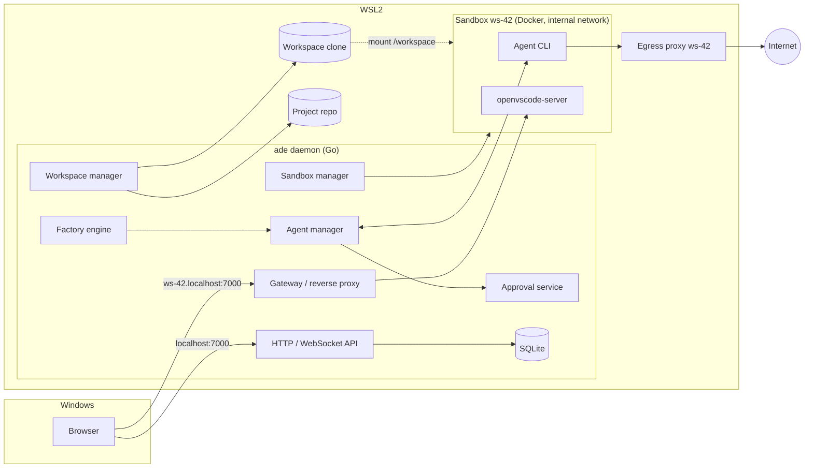
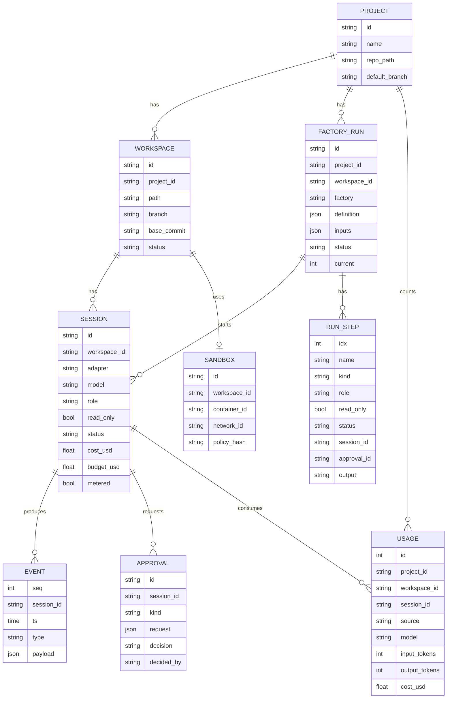

# Architecture

## 1. Overview

ADE consists of **one Go binary** (`ade`) that runs as a daemon in WSL, and a **web dashboard**
embedded into this binary. Every agent gets a **workspace**, optionally with a **sandbox
container**, in which the **browser IDE** runs as well.



### Guiding principles

1. **Daemon first, the UI is replaceable.** Agents keep running when the browser is closed.
   Everything the UI can do is also possible through the API (CLI, later mobile).
2. **Isolation instead of trust.** Every agent has its own workspace; in the sandbox it cannot
   publish anything (no push, no secrets) – the daemon does that after review.
3. **The human approves.** Merges, pushes and policy exceptions always go through an approval.
4. **Agent-agnostic.** Agent CLIs are connected through adapters, not hard-wired.
5. **One binary, few dependencies.** Go + embedded frontend + SQLite (pure Go) + Docker.

## 2. Components

### 2.1 Daemon (`ade serve`)

| Module | Task |
|---|---|
| `api` | REST + WebSocket for the dashboard; auth, host/origin check. |
| `gateway` | Reverse proxy for browser IDEs (`ws-<id>.localhost`) incl. WebSocket upgrade. |
| `project` | Register projects (path to the repository), read the project configuration from `.ade/`. |
| `workspace` | Create workspaces (local clone), compute diffs, merge/PR/discard. |
| `agent` | Life cycle of agent sessions; PTY; adapters; event normalization. |
| `sandbox` | Docker containers and networks per workspace (see [sandbox.md](sandbox.md)). |
| `proxy` | Egress proxy (runs as `ade proxy` in the proxy container), control API; `sandbox` distributes policies and collects events. |
| `ide` | Start/stop openvscode-server (in the sandbox or locally). |
| `approval` | Approval queue; blocking requests from agents/hooks. |
| `factory` | Factory definitions and run state machine (see [factory.md](factory.md)). |
| `trigger` | Triggers: GitHub issues with a label and schedules start runs (`triggers` in `project.yaml`). |
| `provider` | Adapter → provider, model aliases, price table and cost calculation (M8, [4.4](#44-costs-and-budgets)). |
| `store` | SQLite with migrations; events, sessions, runs, approvals. |
| `config` | Global (`~/.config/ade/config.yaml`) and project configuration (`.ade/`). |

### 2.2 Dashboard (`web/`)

Single-page app (React + Vite + TypeScript), embedded into the binary with `go:embed`.

- **Overview:** projects, running agents, status, costs, open approvals.
- **Agent view:** timeline of events (messages, tool calls, results), live terminal (xterm.js),
  input for follow-up instructions, stop/resume.
- **Review:** diff of the workspace branch against the base (Monaco Diff Editor); actions
  *Merge*, *Create PR*, *Discard*, *Feedback to agent*.
- **Open IDE:** link/tab to `http://ws-<id>.localhost:7000/`.
- **Sandbox:** egress log (which domains were requested/blocked), network exceptions.
- **Factories:** runs, pipeline visualization, gates.

### 2.3 Agent adapters

An adapter knows a specific agent CLI and delivers normalized events
(`internal/agent/adapter`). Adapters are stateless; the agent manager (`internal/agent`) starts
and supervises the processes. How to write one: [adapters.md](adapters.md).

```go
type Adapter interface {
    Name() string
    // Capabilities: Terminal (runs in a PTY, no parsing), Input (follow-up instructions),
    // Resume (continue after the process ended), Approvals (hook).
    Capabilities() Capabilities
    // Command builds the process call (program, arguments, environment, first stdin input).
    Command(spec Spec) (*Cmd, error)
    // Parse reads stdout until EOF and reports events, the CLI's resume ID and the end of a turn.
    Parse(r io.Reader, sink Sink) error
    // EncodeInput translates a follow-up instruction into bytes for stdin.
    EncodeInput(text string) ([]byte, error)
}

type Sink interface {
    Emit(typ string, payload any)
    SetResumeID(id string)
    TurnDone() // agent waits for the next instruction → status "idle"
    Baseline() Tokens
}
```

The manager starts the process in the workspace directory with a **controlled environment**:
only an allowlist of the daemon's environment (`HOME`, `PATH`, `LANG`, `LC_*`, WSL variables …)
plus `ADE_SESSION_ID`, `ADE_WORKSPACE_ID`, `ADE_WORKSPACE_PATH` and adapter-specific variables
(e.g. `ANTHROPIC_API_KEY` from the configuration). An agent never inherits tokens like
`GH_TOKEN` or `SSH_AUTH_SOCK`. Structured adapters run with pipes, terminal adapters with a PTY
(`creack/pty`); both in their own process group, stopping = SIGTERM, SIGKILL after 5 s.

| Adapter | Call (check against the current CLI docs when implementing) | Events |
|---|---|---|
| `claude` | `claude -p --input-format stream-json --output-format stream-json --verbose [--model] [--permission-mode] [--settings <approval hook>] [--resume]` | structured (text, tool calls, costs); follow-up instructions via stdin, resuming with `--resume` |
| `codex` | `codex exec --json --skip-git-repo-check [--model] (--sandbox <mode> \| --dangerously-bypass-approvals-and-sandbox) [-c model_provider=ade …] [resume <thread_id>] -` | structured (text, commands, file changes, tokens); one instruction per process via stdin, follow-up instructions by resuming; no approvals |
| `pty` | any command in a terminal (interactive) | terminal stream only, no parsing |

The `pty` adapter is the fallback: any CLI can be used interactively this way, just without a
timeline. The daemon buffers its output (last 256 KiB in memory for newly connected clients,
everything up to 32 MiB in `<data_dir>/sessions/<id>.log`), so it stays visible after
reconnecting and restarting.

**Session status:** `starting` (waits for the workspace setup if needed) → `running` ⇄ `idle`
(waits for an instruction) → `done` | `failed` | `stopped` | `interrupted` | `paused` (budget
exceeded, waits for approval, [4.4](#44-costs-and-budgets)). At most one agent runs per
workspace; terminals next to it are allowed. If the daemon is stopped or crashes, running
sessions count as `interrupted`; on the next start the daemon ends orphaned processes (detected
via `ADE_SESSION_ID` in `/proc/<pid>/environ`). Sessions with a resume ID can be continued with
a new instruction.

### 2.4 Browser IDE

- **openvscode-server** (MIT) runs **in the same container as the agent** and therefore sees
  exactly the same files and tools. Without a sandbox it runs as a local process.
- Reachable through **subdomain routing**: `ws-<id>.localhost:7000` → gateway → container port.
  Reasons: VS Code does not handle sub-paths reliably, and every IDE gets its own browser origin
  (separate cookies/storage). Chromium and Firefox resolve `*.localhost` to loopback.
- Extensions come from **Open VSX**, not from the Microsoft marketplace.
- The daemon sets a random `connection-token`; the gateway passes it through, the user never
  sees it.
- Flow "Open IDE": the dashboard tab `/ide/<id>` starts the IDE (`POST /api/workspaces/{id}/ide`),
  waits for `running`, fetches a one-time ticket and redirects to
  `ws-<id>.localhost:7000/_ade/login?ticket=…`. The gateway exchanges the ticket for a cookie
  only for this subdomain (ADR-012). Without an open connection the IDE stops after
  `ide.idle_timeout`; opening it again restarts it.

## 3. Data model



### Event schema

All adapters produce the same format; the UI only knows this one.

```json
{
  "seq": 1842,
  "session_id": "s_7f3a",
  "ts": "2026-11-26T18:02:11Z",
  "type": "tool_call",
  "payload": { "tool": "Bash", "input": { "command": "go test ./..." } }
}
```

`type` ∈ `status | message | thinking | tool_call | tool_result | cost | error` (M2), `usage`
(M8), later `approval_request | approval_decision | egress | …`. Payloads and required fields are
described by the JSON schema
[`internal/agent/adapter/event.schema.json`](../internal/agent/adapter/event.schema.json); the Go
types are in `internal/agent/adapter/events.go`. Clients show unknown types generically.

- `seq` is gapless per session, starting at 1. Events are distributed live and written in
  batches (after 100 ms or 256 events at the latest, one transaction).
- `WS /ws/sessions/{id}/events?since=<seq>` first delivers all stored events with a greater
  `seq`, then live ones. If a client cannot keep up, the daemon closes with code 4000; the client
  reconnects with the last `seq`.
- `WS /ws/sessions/{id}/pty`: binary messages are terminal data (both directions), text messages
  control commands (`{"type":"resize","cols":…,"rows":…}`, from the daemon `{"type":"exit"}`).

## 4. Key flows

### 4.1 Starting an agent

```mermaid
sequenceDiagram
    participant U as Dashboard
    participant D as Daemon
    participant G as Git
    participant S as Docker
    participant A as Agent CLI

    U->>D: POST /api/agents {project, task, adapter, sandbox}
    D->>G: git clone --local repo → ~/.ade/workspaces/<id>; checkout -b ade/<id>
    alt sandbox active
        D->>S: network + proxy container + agent container (mount /workspace)
        D->>S: docker exec: openvscode-server, agent CLI
    else local
        D->>A: process with PTY in the workspace
    end
    A-->>D: stream-json events
    D-->>U: WebSocket /ws/sessions/<id>
```

If the repository and `workspaces_dir` are on different file systems, hardlinks are not
possible; ADE then clones with `--no-hardlinks` (objects are copied).

### 4.2 Review and delivery

1. The agent reports *done* (turn finished, status `idle`) or the process ends.
2. The daemon commits open changes in the workspace if there are any (`ade: wip <session-id>`),
   without hooks and signature.
3. The daemon fetches the branch into the project repository:
   `git -C <repo> fetch <workspace> +ade/<id>:ade/<id>`. This is the only change to the project
   repository without a user action (ADR-013).
4. The dashboard shows the workspace's diff against `base_commit` (file list without patches;
   the Monaco Diff Editor loads both file versions only when selected, via
   `GET /api/workspaces/{id}/file`).
5. The user chooses:
   - **Merge:** check conflicts beforehand with `git merge-tree --write-tree` – with conflicts
     nothing changes. If the base branch is checked out in the project repository,
     `git merge --no-ff` runs in its working tree; otherwise the merge commit is created without
     a working tree (`commit-tree`, `update-ref` with the expected old value).
   - **Create PR:** `git push origin ade/<id>` from the host, then `gh pr create` with a
     generated description (task, feedback, file list). Later pushes update the PR.
   - **Feedback:** new session in the same workspace (role `feedback`) with the comment and the
     current diff as the instruction; a waiting agent is ended first. Its end produces another
     commit on the same branch.
   - **Discard:** stop sessions, delete IDE data, terminal logs, workspace directory, branch
     `ade/<id>` in the project repository and the records. A pushed branch and the PR stay.

Merge and PR wait until no agent is working in the workspace any more. The agent itself has **no
push rights** – publishing is always a daemon step after approval.

### 4.3 Approvals

Agent CLIs offer hook or permission mechanisms. For Claude Code, ADE registers
`ade hook pretooluse` as a `PreToolUse` hook for all tools when a session starts (`--settings`,
ADR-016). The hook sends tool and input to ADE and **blocks** until there is a decision; on any
error the answer is `deny`.

- **Locally** the hook asks the daemon directly (`POST /api/hook/pretooluse`, token per session).
- **In the sandbox** the read-only mounted ade binary runs in the container and asks the egress
  proxy (`http://proxy:8080/ade/hook/pretooluse`). The proxy holds the question, the daemon
  fetches it through the control API and answers (the container never reaches the daemon
  directly).

The daemon first checks the project's **rules**, separately for sandbox and local:

```yaml
# .ade/project.yaml
approvals:
  sandbox:                     # default: allow: ["*"]
    allow: ["*"]
    deny: ["Bash(git push *)"]
  local:                       # default: reading and editing files in the workspace
    allow: ["Read(**)", "Grep(**)", "Glob(**)", "Edit(**)", "Write(**)", "Bash(go test *)"]
    ask: ["Edit(.github/**)"]
```

Entries are `Tool` or `Tool(pattern)`: commands for `Bash` (a trailing ` *` also matches without
arguments; allow rules never match compound commands with `;`, `&&`, `|`, redirections or
`$(…)`), paths for file tools (relative to the workspace, `*` within a directory, `**` across
directories; absolute paths and `~/…` for targets outside), hosts for `WebFetch`, wildcards in
the tool name (`mcp__*`). Order: deny → ask → allow; anything no rule allows becomes an
**approval request**. If `project.yaml` is invalid, no rule allows anything.

Approval requests appear on the **Approvals** page (badge in the navigation, browser
notification) and in the session view. Without a decision a request counts as denied after
`approvals.timeout` (global configuration, default 10m); a reason given when denying goes back to
the agent as feedback. The same queue takes the sandbox's network approvals
(`egress.on_blocked: ask`, [sandbox.md](sandbox.md#3-egress-proxy-ade-proxy)).

Rule of thumb: **generous in the sandbox, strict outside.** The sandbox limits the damage, so not
every `ls` needs to be confirmed; approvals remain for network exceptions, merges and pushes.
Terminal sessions (`pty`) have no hook, neither does Codex (`codex exec` does not ask; locally
`--sandbox workspace-write` limits the write permissions).

### 4.4 Costs and budgets

Every usage ends up in the table `usage` (project, workspace, session, source, model, tokens, USD)
and is added to the session. There are two sources, exactly one applies per session:

- **Proxy:** in the sandbox with secret injection (key in `providers.<provider>`), the egress
  proxy reads the token usage from every response of `/p/<provider>/…` (Anthropic Messages and
  OpenAI Responses/Chat, JSON and SSE). The daemon converts it to USD with the price table and
  assigns it to the agent in the workspace (event `usage`). The CLI's report at the end of a turn
  then no longer counts.
- **CLI:** otherwise the CLI's report counts: Claude Code delivers USD, Codex only tokens (ADE
  converts them and marks the costs as estimated).

The price table is built in (date shown in the dashboard) and can be extended with `pricing` in
the global configuration. For models without a price ADE only counts tokens and marks the costs
as incomplete. **Model aliases** (`models`) map names like `opus` to a provider and model ID; the
provider must match the adapter.

**Budgets** are set in `.ade/project.yaml` (`budget.session_usd`, `budget.monthly_usd`) or at
start (`budget_usd`). After every usage (with the proxy live, otherwise after every turn) the
daemon checks both limits. If one is reached, it ends the agent with status `paused` and creates
an approval of kind `budget` (valid for 24 h). "Raise budget" allows another step (session
budget or 10 % of the monthly budget) and resumes the session, "Deny" ends it. A paused agent that
is resumed by hand pauses again right away and asks anew.

### 4.5 Factory runs

A run (`internal/factory`, tables `runs` and `run_steps`) stores the factory definition at start
and creates a workspace. The runner advances it step by step; it is driven by status changes of
its sessions, decisions at gates, a tick (30 s, time limit) and the daemon start:

1. **Role:** starts a normal agent session in the workspace (role, adapter, model alias, the
   run's remaining budget as session budget). The instruction consists of the role prompt, the
   task, notes from the gates and the artifacts the role lists as `inputs`. When the agent is
   done (`idle`/`done`), its last answer becomes the role's artifact
   (`<data_dir>/runs/<run>/<name>`), a waiting agent is ended and the workspace state is saved.
   `paused` (budget) pauses the run, `failed`/`stopped` makes it fail.
2. **Gate** (`gate: human`): creates an approval of kind `gate` (7 days). "Approve" continues, a
   reason goes to the next roles as a note; "Deny" cancels the run.
3. **Pull request** (`action: pull_request`): push and `gh pr create` as in delivery (4.2); the
   description contains the artifacts.

**Read-only roles** (`permissions: read`) do not change the workspace: in the sandbox they run in
a second container of the workspace (`ade-ws-<id>-ro`, same internal network and same proxy) that
mounts `/workspace` read-only. Without a sandbox they work in a snapshot (`git clone --shared` of
the workspace including the base branch under `<data_dir>/snapshots/<session>`) that is deleted
with the session; in addition Claude Code blocks `Edit`/`Write`, and Codex runs with
`--sandbox read-only`.

**Restart:** on start the runner continues active runs: interrupted sessions via resume, gates
with a new approval (the old one expired with the restart).

## 5. API outline

| Method | Path | Purpose |
|---|---|---|
| `GET/POST` | `/api/projects` | List / register projects |
| `GET/POST` | `/api/projects/{id}/workspaces` | Workspaces |
| `GET` | `/api/workspaces/{id}/diff` | Diff against the base |
| `GET` | `/api/workspaces/{id}/file?path=&old_path=` | File in the base commit and in the workspace (diff editor) |
| `POST` | `/api/workspaces/{id}/collect` | WIP commit and fetch into the project repository |
| `POST` | `/api/workspaces/{id}/merge` | Merge into the base branch (409 with `conflicts`) |
| `GET/POST` | `/api/workspaces/{id}/pull-request` | PR draft / push and `gh pr create` |
| `POST` | `/api/workspaces/{id}/feedback` | Start a feedback session |
| `DELETE` | `/api/workspaces/{id}` | Discard |
| `GET` | `/api/sandbox` | Docker reachable?, default image, default setting, runtime |
| `POST` | `/api/sandbox/gc[?dry_run=1]` | Remove orphaned sandbox containers (`ade gc`) |
| `GET` | `/api/workspaces/{id}/sandbox` | Containers of a workspace (status, image) |
| `GET` | `/api/adapters` | Available adapters, capabilities, modes per adapter, model aliases |
| `GET` | `/api/usage[?project_id]` | Costs and tokens: total, month, per project or per workspace, monthly budget |
| `POST` | `/api/agents` | Start an agent session (`project_id`, optional `workspace_id`, `adapter`, `task`, `command`, `model` (alias or ID), `permission_mode`, `sandbox`, `budget_usd`) |
| `GET` | `/api/sessions[?project_id&workspace_id&active=true]`, `/api/sessions/{id}` | Sessions |
| `GET` | `/api/sessions/{id}/events?since=<seq>` | Stored events (JSON, for CLI/tests) |
| `POST` | `/api/sessions/{id}/input` \| `/stop` | Follow-up instruction or resume / stop |
| `WS` | `/ws/sessions/{id}/events` | Event stream (with `?since=<seq>` for replay) |
| `WS` | `/ws/sessions/{id}/pty` | Terminal |
| `GET` | `/api/approvals[?status&session_id&workspace_id]`, `/api/approvals/{id}` | Approvals |
| `POST` | `/api/approvals/{id}` | Decide (`decision`: `allow`, `deny`, for egress also `allow_workspace`, `allow_project`; `reason`); kinds `tool`, `egress`, `budget`, `gate` |
| `POST` | `/api/hook/pretooluse` | Question of the hook of local agents (session token instead of login) |
| `POST` | `/api/workspaces/{id}/egress/grants`, `DELETE /api/egress-grants/{id}` | Egress exceptions (`rule`, `scope`: `workspace`/`project`) |
| `GET` | `/api/workspaces/{id}/egress[?blocked=1]` | Egress events, summary per host, effective policy (edited in `.ade/sandbox.yaml`) |
| `GET` | `/api/factories?project_id=` | Factories of a project (own ones and templates, with validation errors) |
| `GET/POST` | `/api/runs[?project_id&workspace_id&active=1]` | List / start runs (`project_id`, `factory`, `task`, `inputs`, `sandbox`) |
| `GET` | `/api/runs/{id}` | Run with steps, artifacts and PR |
| `POST` | `/api/runs/{id}/cancel` | Cancel a run (stop the running session, withdraw the gate) |
| `GET` | `/api/runs/{id}/artifacts/{name}[?iteration=N]` | Artifact as text (latest version or from pass N) |
| `GET` | `/api/projects/{id}/triggers` | Triggers with state, next date and latest runs |
| `POST` | `/api/projects/{id}/triggers/{name}/pause`, `…/resume` | Pause / resume a trigger |

## 6. Configuration

```
~/.config/ade/config.yaml      # global: port, providers, API keys (references), defaults
~/.local/share/ade/ade.db      # SQLite
~/.ade/workspaces/<id>/        # workspace clones (Linux file system!)

<repo>/.ade/
├── project.yaml               # name, base branch, default adapter, setup commands, approvals, budget, triggers
├── sandbox.yaml               # image, limits, egress allowlist
└── factories/
    └── feature.yaml           # factory definitions
```

Every option is described in the [configuration reference](configuration.md). Example
`~/.config/ade/config.yaml`:

```yaml
listen: 127.0.0.1:7000
providers:
  anthropic:
    api_key: env:ANTHROPIC_API_KEY
  openai:
    api_key: env:OPENAI_API_KEY
models:               # aliases for sessions and factories
  opus: { provider: anthropic, id: claude-opus-5-5 }
  gpt:  { provider: openai,    id: gpt-5.3-codex }
pricing:              # extends the built-in price table (USD per million tokens)
  my-model: { input: 1, output: 4 }
defaults:
  adapter: claude
  sandbox: true
approvals:
  timeout: 10m        # waiting time for an approval, denied afterwards
ide:
  binary: ""          # empty = download the pinned openvscode-server version (ADR-012)
  idle_timeout: 15m
```

## 7. Security

The complete threat model with residual risks is in [threat-model.md](threat-model.md).

| Risk | Measure |
|---|---|
| Foreign websites access `localhost:7000` (CSRF, DNS rebinding) | Bind only `127.0.0.1`; the `Host` header must be `localhost`/`*.localhost`; `Origin` check for WebSockets; session token (start URL with one-time token → HttpOnly cookie). |
| Agent reads/exfiltrates secrets | No secrets in the container; the egress proxy inserts API keys ([sandbox.md](sandbox.md#4-secrets)). |
| Agent attacks arbitrary hosts / downloads malware | Internal Docker network, only the proxy with an allowlist; egress log in the dashboard. |
| Agent manipulates the main repository (hooks, other branches) | The workspace is a separate clone; the main repository is never mounted. |
| Container escape | `cap-drop ALL`, `no-new-privileges`, non-root user, no Docker socket in the container, resource limits. |
| Prompt injection through repository contents | Limited by the isolation above; merge only after human review. |

## 8. WSL specifics

- **Repositories and workspaces on the Linux file system** (`~/…`), never under `/mnt/c` – file
  access across the 9P boundary is orders of magnitude slower. `ade project add` warns about
  `/mnt/*`.
- **localhost forwarding:** ports from WSL are reachable from Windows via `localhost`.
  `ade start` opens the browser via `wslview` or `explorer.exe`.
- **Docker Engine in WSL** (Docker Desktop not required); rootless Docker and Podman work too
  ([sandbox.md](sandbox.md#6-container-runtimes)).
- **Background service:** with `systemd=true` in `/etc/wsl.conf` the daemon runs as a
  `systemctl --user` service (`ade install-service`, ADR-021). The unit takes over the shell's
  `PATH` and writes to the normal daemon log; `ade start` then starts the service.

## 9. Tech stack

| Area | Choice |
|---|---|
| Backend language | Go (current stable version) |
| HTTP/WebSocket | `net/http` (Go ≥ 1.22 routing), `github.com/coder/websocket` |
| PTY | `github.com/creack/pty` |
| Database | SQLite via `modernc.org/sqlite` (no cgo) |
| Docker | Docker CLI (ADR-014) |
| Configuration | YAML (`go.yaml.in/yaml/v3`) |
| Frontend | React + Vite + TypeScript, xterm.js, Monaco (diff), TanStack Query |
| IDE | openvscode-server (MIT) |
| Model gateway (optional) | LiteLLM (MIT) |
| CI | GitHub Actions: `go test`, `golangci-lint`, frontend build, release via GoReleaser |

## 10. Repository layout

```
ade/
├── cmd/ade/                 # main: serve, start, proxy, hook, project, …
├── internal/
│   ├── api/                 # HTTP + WS handlers, auth
│   ├── gateway/             # reverse proxy for IDEs
│   ├── project/
│   ├── workspace/           # clone, diff, merge, PR
│   ├── agent/
│   │   └── adapter/         # claude/, codex/, pty/
│   ├── sandbox/             # Docker containers (Docker CLI), sandbox.yaml, GC
│   ├── proxy/               # egress proxy (ade proxy), allowlist, control API
│   ├── ide/                 # openvscode-server
│   ├── approval/
│   ├── factory/             # factory definitions, runner (runs, gates, artifacts, loops)
│   ├── trigger/             # triggers: GitHub issues (gh), schedule
│   ├── cron/                # cron expressions
│   ├── provider/
│   ├── store/               # SQLite + migrations/
│   └── config/
├── web/                     # dashboard (Vite), build → internal/api/dist (go:embed)
├── images/
│   ├── agent-base/          # Dockerfile: Debian, git, node, agent CLIs, openvscode-server
│   └── ade-dev/             # Dockerfile: development image based on agent-base
├── examples/                # example configurations, factory templates (factories/, embedded)
├── doc/
├── LICENSE
└── README.md
```
