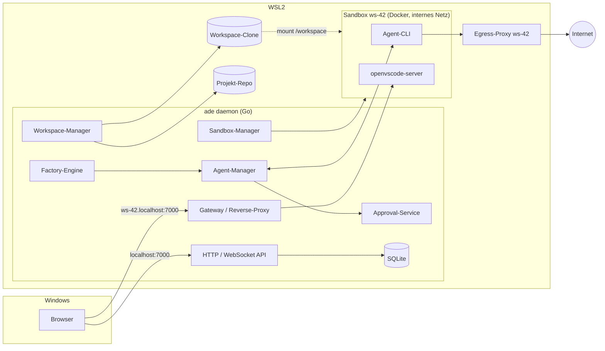
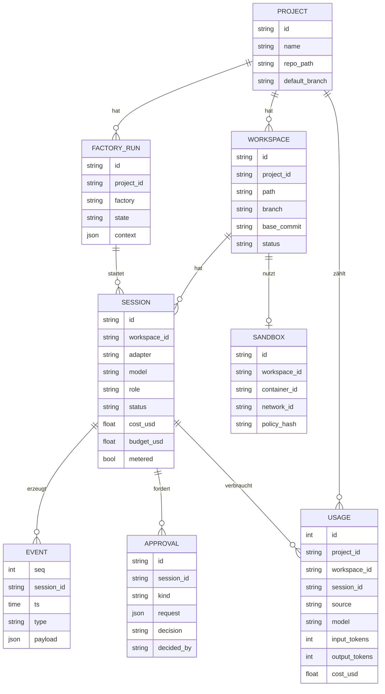

# Architektur

## 1. Überblick

ADE besteht aus **einem Go-Binary** (`ade`), das als Daemon in der WSL läuft, und einem
**Web-Dashboard**, das in dieses Binary eingebettet ist. Pro Agent entsteht ein **Workspace**,
optional mit **Sandbox-Container**, in dem auch die **Browser-IDE** läuft.



### Leitprinzipien

1. **Daemon zuerst, UI ist austauschbar.** Agenten laufen weiter, wenn der Browser zu ist.
   Alles, was die UI kann, geht auch über die API (später CLI, Mobile).
2. **Isolation statt Vertrauen.** Jeder Agent hat seinen eigenen Workspace; in der Sandbox
   kann er nichts veröffentlichen (kein Push, keine Secrets) – das macht der Daemon nach Review.
3. **Der Mensch gibt frei.** Merges, Pushes und Policy-Ausnahmen laufen immer über eine Freigabe.
4. **Agent-agnostisch.** Agent-CLIs werden über Adapter angebunden, nicht fest verdrahtet.
5. **Ein Binary, wenig Abhängigkeiten.** Go + eingebettetes Frontend + SQLite (pure Go) + Docker.

## 2. Komponenten

### 2.1 Daemon (`ade serve`)

| Modul | Aufgabe |
|---|---|
| `api` | REST + WebSocket für das Dashboard; Auth, Host-/Origin-Prüfung. |
| `gateway` | Reverse-Proxy für Browser-IDEs (`ws-<id>.localhost`) inkl. WebSocket-Upgrade. |
| `project` | Projekte registrieren (Pfad zum Repo), Projekt-Konfiguration aus `.ade/` lesen. |
| `workspace` | Workspaces anlegen (lokaler Clone), Diff berechnen, Merge/PR/Verwerfen. |
| `agent` | Lebenszyklus von Agent-Sessions; PTY; Adapter; Event-Normalisierung. |
| `sandbox` | Docker-Container und -Netzwerke pro Workspace (siehe [sandbox.md](sandbox.md)). |
| `proxy` | Egress-Proxy (läuft als `ade proxy` im Proxy-Container), Steuer-API; Policy-Verteilung und Event-Abholung macht `sandbox`. |
| `ide` | openvscode-server starten/stoppen (in der Sandbox oder lokal). |
| `approval` | Freigabe-Warteschlange; blockierende Anfragen von Agenten/Hooks. |
| `factory` | Fabrik-Definitionen und Run-Zustandsmaschine (siehe [factory.md](factory.md)). |
| `provider` | Adapter → Anbieter, Modell-Aliase, Preistabelle und Kostenberechnung (M8, [4.4](#44-kosten-und-budgets)). |
| `store` | SQLite mit Migrationen; Events, Sessions, Runs, Freigaben. |
| `config` | Globale (`~/.config/ade/config.yaml`) und Projekt-Konfiguration (`.ade/`). |

### 2.2 Dashboard (`web/`)

Single-Page-App (React + Vite + TypeScript), per `go:embed` ins Binary eingebettet.

- **Übersicht:** Projekte, laufende Agenten, Status, Kosten, offene Freigaben.
- **Agent-Ansicht:** Timeline der Events (Nachrichten, Tool-Aufrufe, Ergebnisse), Live-Terminal
  (xterm.js), Eingabe für Folgeanweisungen, Stop/Fortsetzen.
- **Review:** Diff des Workspace-Branches gegen die Basis (Monaco Diff Editor);
  Aktionen *Mergen*, *PR erstellen*, *Verwerfen*, *Feedback an Agent*.
- **IDE öffnen:** Link/Tab auf `http://ws-<id>.localhost:7000/`.
- **Sandbox:** Egress-Log (welche Domains wurden angefragt/geblockt), Policy bearbeiten.
- **Fabriken:** Runs, Pipeline-Visualisierung, Gates.

### 2.3 Agent-Adapter

Ein Adapter kennt eine konkrete Agent-CLI und liefert normalisierte Events
(`internal/agent/adapter`). Adapter sind zustandslos; Prozesse startet und überwacht der
Agent-Manager (`internal/agent`).

```go
type Adapter interface {
    Name() string
    // Capabilities: Terminal (läuft im PTY, kein Parsing), Input (Folgeanweisungen),
    // Resume (Fortsetzen nach Prozessende).
    Capabilities() Capabilities
    // Command baut den Prozessaufruf (Programm, Argumente, Umgebung, erste Eingabe für stdin).
    Command(spec Spec) (*Cmd, error)
    // Parse liest stdout bis EOF und meldet Events, die Resume-ID der CLI und Durchgangsende.
    Parse(r io.Reader, sink Sink) error
    // EncodeInput übersetzt eine Folgeanweisung in Bytes für stdin.
    EncodeInput(text string) ([]byte, error)
}

type Sink interface {
    Emit(typ string, payload any)
    SetResumeID(id string)
    TurnDone() // Agent wartet auf die nächste Anweisung → Status "idle"
}
```

Der Manager startet den Prozess im Workspace-Verzeichnis mit **kontrollierter Umgebung**: nur
eine Allowlist der Daemon-Umgebung (`HOME`, `PATH`, `LANG`, `LC_*`, WSL-Variablen …) plus
`ADE_SESSION_ID`, `ADE_WORKSPACE_ID`, `ADE_WORKSPACE_PATH` und adapterspezifische Variablen
(z. B. `ANTHROPIC_API_KEY` aus der Konfiguration). Tokens wie `GH_TOKEN` oder `SSH_AUTH_SOCK`
erbt ein Agent nicht. Strukturierte Adapter laufen mit Pipes, Terminal-Adapter mit PTY
(`creack/pty`); beide in eigener Prozessgruppe, Stoppen = SIGTERM, nach 5 s SIGKILL.

| Adapter | Aufruf (beim Implementieren gegen aktuelle CLI-Doku prüfen) | Events |
|---|---|---|
| `claude` | `claude -p --input-format stream-json --output-format stream-json --verbose [--model] [--permission-mode] [--settings <Freigabe-Hook>] [--resume]` | strukturiert (Text, Tool-Calls, Kosten); Folgeanweisungen über stdin, Fortsetzen mit `--resume` |
| `codex` | `codex exec --json --skip-git-repo-check [--model] (--sandbox <modus> \| --dangerously-bypass-approvals-and-sandbox) [-c model_provider=ade …] [resume <thread_id>] -` | strukturiert (Text, Befehle, Dateiänderungen, Tokens); eine Anweisung je Prozess über stdin, Folgeanweisungen durch Fortsetzen; keine Freigaben |
| `pty` | beliebiger Befehl im Terminal (interaktiv) | nur Terminal-Stream, kein Parsing |

Der `pty`-Adapter ist der Fallback: Jede CLI lässt sich so interaktiv bedienen, nur ohne Timeline.
Seine Ausgabe puffert der Daemon (letzte 256 KiB im Speicher für neu verbundene Clients, alles
bis 32 MiB in `<data_dir>/sessions/<id>.log`), damit sie nach Neuverbinden und Neustart sichtbar bleibt.

**Session-Status:** `starting` (wartet ggf. auf das Workspace-Setup) → `running` ⇄ `idle`
(wartet auf Anweisung) → `done` | `failed` | `stopped` | `interrupted` | `paused` (Budget
überschritten, wartet auf Freigabe, [4.4](#44-kosten-und-budgets)). Pro Workspace läuft
höchstens ein Agent; Terminals daneben sind erlaubt. Wird der Daemon beendet oder stürzt er ab,
gelten laufende Sessions als `interrupted`; beim nächsten Start beendet der Daemon verwaiste
Prozesse (erkannt über `ADE_SESSION_ID` in `/proc/<pid>/environ`). Sessions mit Resume-ID lassen
sich mit einer neuen Anweisung fortsetzen.

### 2.4 Browser-IDE

- **openvscode-server** (MIT) läuft **im selben Container wie der Agent** und sieht damit
  exakt dieselben Dateien und Werkzeuge. Ohne Sandbox läuft er als lokaler Prozess.
- Erreichbar über **Subdomain-Routing**: `ws-<id>.localhost:7000` → Gateway → Container-Port.
  Gründe: VS Code mag keine Unterpfade zuverlässig, und jede IDE bekommt einen eigenen
  Browser-Origin (Cookies/Storage getrennt). Chromium und Firefox lösen `*.localhost` auf
  Loopback auf.
- Extensions kommen aus **Open VSX**, nicht aus dem Microsoft-Marketplace.
- Der Daemon setzt einen zufälligen `connection-token`; das Gateway reicht ihn durch,
  der Nutzer sieht ihn nie.
- Ablauf „IDE öffnen“: Dashboard-Tab `/ide/<id>` startet die IDE (`POST /api/workspaces/{id}/ide`),
  wartet auf `running`, holt ein Einmal-Ticket und leitet auf
  `ws-<id>.localhost:7000/_ade/login?ticket=…` weiter. Das Gateway tauscht das Ticket gegen ein
  Cookie nur für diese Subdomain (ADR-012). Ohne offene Verbindung stoppt die IDE nach
  `ide.idle_timeout`; ein erneuter Aufruf startet sie wieder.

## 3. Datenmodell



### Event-Schema

Alle Adapter erzeugen dasselbe Format; die UI kennt nur dieses.

```json
{
  "seq": 1842,
  "session_id": "s_7f3a",
  "ts": "2026-11-26T18:02:11Z",
  "type": "tool_call",
  "payload": { "tool": "Bash", "input": { "command": "go test ./..." } }
}
```

`type` ∈ `status | message | thinking | tool_call | tool_result | cost | error` (M2), `usage` (M8), später
`approval_request | approval_decision | egress | …`. Payloads und Pflichtfelder beschreibt das
JSON-Schema [`internal/agent/adapter/event.schema.json`](../internal/agent/adapter/event.schema.json);
die Go-Typen stehen in `internal/agent/adapter/events.go`. Clients zeigen unbekannte Typen generisch an.

- `seq` ist pro Session lückenlos ab 1. Events werden live verteilt und gebündelt geschrieben
  (spätestens nach 100 ms oder 256 Events, eine Transaktion).
- `WS /ws/sessions/{id}/events?since=<seq>` liefert erst alle gespeicherten Events mit größerer
  `seq`, dann live. Kommt ein Client nicht hinterher, schließt der Daemon mit Code 4000; der
  Client verbindet sich mit der letzten `seq` neu.
- `WS /ws/sessions/{id}/pty`: Binärnachrichten sind Terminal-Daten (beide Richtungen),
  Textnachrichten Steuerbefehle (`{"type":"resize","cols":…,"rows":…}`, vom Daemon `{"type":"exit"}`).

## 4. Wichtige Abläufe

### 4.1 Agent starten

```mermaid
sequenceDiagram
    participant U as Dashboard
    participant D as Daemon
    participant G as Git
    participant S as Docker
    participant A as Agent-CLI

    U->>D: POST /api/agents {project, task, adapter, sandbox}
    D->>G: git clone --local repo → ~/.ade/workspaces/<id>; checkout -b ade/<id>
    alt Sandbox aktiv
        D->>S: Netzwerk + Proxy-Container + Agent-Container (mount /workspace)
        D->>S: docker exec: openvscode-server, Agent-CLI
    else lokal
        D->>A: Prozess mit PTY im Workspace
    end
    A-->>D: stream-json Events
    D-->>U: WebSocket /ws/sessions/<id>
```

Liegen Repo und `workspaces_dir` auf verschiedenen Dateisystemen, sind keine Hardlinks möglich;
dann klont ADE mit `--no-hardlinks` (Objekte werden kopiert).

### 4.2 Review und Übernahme

1. Agent meldet *fertig* (Runde beendet, Status `idle`) oder der Prozess endet.
2. Daemon committet ggf. offene Änderungen im Workspace (`ade: wip <session-id>`), ohne Hooks
   und Signatur.
3. Daemon holt den Branch ins Projekt-Repo: `git -C <repo> fetch <workspace> +ade/<id>:ade/<id>`.
   Das ist die einzige Änderung am Projekt-Repo ohne Nutzeraktion (ADR-013).
4. Dashboard zeigt den Diff des Workspaces gegen `base_commit` (Dateiliste ohne Patches; die
   beiden Dateistände lädt der Monaco Diff Editor erst bei Auswahl über
   `GET /api/workspaces/{id}/file`).
5. Nutzer wählt:
   - **Mergen:** Konflikte vorab mit `git merge-tree --write-tree` prüfen – bei Konflikten ändert
     sich nichts. Ist der Basis-Branch im Projekt-Repo ausgecheckt, läuft `git merge --no-ff` in
     dessen Arbeitsbaum, sonst entsteht der Merge-Commit ohne Arbeitsbaum (`commit-tree`,
     `update-ref` mit Vergleichswert).
   - **PR erstellen:** `git push origin ade/<id>` vom Host, dann `gh pr create` mit generierter
     Beschreibung (Aufgabe, Feedback, Dateiliste). Weitere Pushes aktualisieren den PR.
   - **Feedback:** neue Session im selben Workspace (Rolle `feedback`) mit Kommentar und aktuellem
     Diff als Anweisung; ein wartender Agent wird vorher beendet. Ihr Ende erzeugt einen weiteren
     Commit im selben Branch.
   - **Verwerfen:** Sessions stoppen, IDE-Daten, Terminal-Logs, Workspace-Verzeichnis, Branch
     `ade/<id>` im Projekt-Repo und Datensätze löschen. Ein gepushter Branch und der PR bleiben.

Mergen und PR warten, bis kein Agent im Workspace mehr arbeitet. Der Agent selbst hat **keine
Push-Rechte** – Veröffentlichen ist immer ein Daemon-Schritt nach Freigabe.

### 4.3 Freigaben

Agent-CLIs bieten Hook- bzw. Permission-Mechanismen. Für Claude Code bindet ADE beim Start einer
Session `ade hook pretooluse` als `PreToolUse`-Hook für alle Werkzeuge ein (`--settings`,
ADR-016). Der Hook schickt Werkzeug und Eingabe an ADE und **blockiert**, bis entschieden ist;
bei jedem Fehler lautet die Antwort `deny`.

- **Lokal** fragt der Hook den Daemon direkt (`POST /api/hook/pretooluse`, Token je Session).
- **In der Sandbox** läuft das nur lesend gemountete ade-Binary im Container und fragt den
  Egress-Proxy (`http://proxy:8080/ade/hook/pretooluse`). Der Proxy hält die Frage, der Daemon
  holt sie über die Steuer-API ab und antwortet (der Container erreicht den Daemon nie direkt).

Der Daemon prüft zuerst die **Regeln** des Projekts, getrennt für Sandbox und lokal:

```yaml
# .ade/project.yaml
approvals:
  sandbox:                     # Voreinstellung: allow: ["*"]
    allow: ["*"]
    deny: ["Bash(git push *)"]
  local:                       # Voreinstellung: Lesen und Dateiänderungen im Workspace
    allow: ["Read(**)", "Grep(**)", "Glob(**)", "Edit(**)", "Write(**)", "Bash(go test *)"]
    ask: ["Edit(.github/**)"]
```

Einträge sind `Tool` oder `Tool(muster)`: Befehle für `Bash` (ein abschließendes ` *` passt auch
ohne Argumente; Allow-Regeln passen nie auf zusammengesetzte Befehle mit `;`, `&&`, `|`,
Umleitungen oder `$(…)`), Pfade für Datei-Werkzeuge (relativ zum Workspace, `*` innerhalb eines
Verzeichnisses, `**` darüber hinaus; absolute Pfade und `~/…` für Ziele außerhalb), Hosts für
`WebFetch`, Platzhalter im Werkzeugnamen (`mcp__*`). Reihenfolge: deny → ask → allow; was keine
Regel erlaubt, wird eine **Freigabe**. Ist `project.yaml` ungültig, erlaubt keine Regel etwas.

Freigaben erscheinen auf der Seite **Freigaben** (Badge in der Navigation, Browser-Benachrichtigung)
und in der Session-Ansicht. Ohne Entscheidung gilt eine Anfrage nach `approvals.timeout`
(globale Konfiguration, Standard 10m) als abgelehnt; eine Begründung beim Ablehnen bekommt der
Agent als Rückmeldung. Dieselbe Warteschlange nimmt Netzwerk-Freigaben der Sandbox auf
(`egress.on_blocked: ask`, [sandbox.md](sandbox.md#3-egress-proxy-ade-proxy)).

Faustregel: **In der Sandbox großzügig, außerhalb streng.** Die Sandbox begrenzt den Schaden,
deshalb muss nicht jeder `ls` bestätigt werden; Freigaben bleiben für Netzwerk-Ausnahmen,
Merges und Pushes. Terminal-Sessions (`pty`) haben keinen Hook, Codex auch nicht (`codex exec`
fragt nicht nach; lokal begrenzt `--sandbox workspace-write` die Schreibrechte).

### 4.4 Kosten und Budgets

Jede Nutzung landet in der Tabelle `usage` (Projekt, Workspace, Session, Quelle, Modell, Tokens,
USD) und wird zur Session addiert. Es gibt zwei Quellen, je Session gilt genau eine:

- **Proxy:** In der Sandbox mit Secret-Injection (Key in `providers.<anbieter>`) liest der
  Egress-Proxy die Token-Nutzung aus jeder Antwort von `/p/<anbieter>/…` (Anthropic Messages und
  OpenAI Responses/Chat, JSON und SSE). Der Daemon rechnet sie mit der Preistabelle in USD um und
  ordnet sie dem Agenten im Workspace zu (Event `usage`). Die Meldung der CLI am Ende eines
  Durchgangs zählt dann nicht mehr.
- **CLI:** Sonst gilt, was die CLI meldet: Claude Code liefert USD, Codex nur Tokens (ADE rechnet
  um und markiert die Kosten als geschätzt).

Die Preistabelle ist eingebaut (Stand im Dashboard) und lässt sich mit `pricing` in der
globalen Konfiguration ergänzen. Für Modelle ohne Preis zählt ADE nur Tokens und markiert die
Kosten als unvollständig. **Modell-Aliase** (`models`) bilden Namen wie `opus` auf Anbieter und
Modell-ID ab; der Anbieter muss zum Adapter passen.

**Budgets** stehen in `.ade/project.yaml` (`budget.session_usd`, `budget.monthly_usd`) oder beim
Start (`budget_usd`). Nach jeder Nutzung (mit Proxy live, sonst nach jedem Durchgang) prüft der
Daemon beide Grenzen. Ist eine erreicht, beendet er den Agenten mit Status `paused` und legt eine
Freigabe der Art `budget` an (24 h gültig). „Budget erhöhen“ gibt einen weiteren Schritt frei
(Session-Budget bzw. 10 % des Monatsbudgets) und setzt die Session fort, „Ablehnen“ beendet sie.
Ein von Hand fortgesetzter, pausierter Agent pausiert sofort wieder und fragt neu.

## 5. API-Skizze

| Methode | Pfad | Zweck |
|---|---|---|
| `GET/POST` | `/api/projects` | Projekte auflisten / registrieren |
| `GET/POST` | `/api/projects/{id}/workspaces` | Workspaces |
| `GET` | `/api/workspaces/{id}/diff` | Diff gegen Basis |
| `GET` | `/api/workspaces/{id}/file?path=&old_path=` | Datei im Basis-Commit und im Workspace (Diff-Editor) |
| `POST` | `/api/workspaces/{id}/collect` | WIP-Commit und Fetch ins Projekt-Repo |
| `POST` | `/api/workspaces/{id}/merge` | In den Basis-Branch mergen (409 mit `conflicts`) |
| `GET/POST` | `/api/workspaces/{id}/pull-request` | PR-Entwurf / Push und `gh pr create` |
| `POST` | `/api/workspaces/{id}/feedback` | Feedback-Session starten |
| `DELETE` | `/api/workspaces/{id}` | Verwerfen |
| `GET` | `/api/sandbox` | Docker erreichbar?, Standard-Image, Voreinstellung |
| `POST` | `/api/sandbox/gc[?dry_run=1]` | Verwaiste Sandbox-Container entfernen (`ade gc`) |
| `GET` | `/api/workspaces/{id}/sandbox` | Container eines Workspaces (Status, Image) |
| `GET` | `/api/adapters` | Verfügbare Adapter, Fähigkeiten, Modi je Adapter, Modell-Aliase |
| `GET` | `/api/usage[?project_id]` | Kosten und Tokens: gesamt, Monat, je Projekt bzw. je Workspace, Monatsbudget |
| `POST` | `/api/agents` | Agent-Session starten (`project_id`, optional `workspace_id`, `adapter`, `task`, `command`, `model` (Alias oder ID), `permission_mode`, `sandbox`, `budget_usd`) |
| `GET` | `/api/sessions[?project_id&workspace_id&active=true]`, `/api/sessions/{id}` | Sessions |
| `GET` | `/api/sessions/{id}/events?since=<seq>` | Gespeicherte Events (JSON, für CLI/Tests) |
| `POST` | `/api/sessions/{id}/input` \| `/stop` | Folgeanweisung bzw. Fortsetzen / Stop |
| `WS` | `/ws/sessions/{id}/events` | Event-Stream (mit `?since=<seq>` für Replay) |
| `WS` | `/ws/sessions/{id}/pty` | Terminal |
| `GET` | `/api/approvals[?status&session_id&workspace_id]`, `/api/approvals/{id}` | Freigaben |
| `POST` | `/api/approvals/{id}` | Entscheiden (`decision`: `allow`, `deny`, bei egress auch `allow_workspace`, `allow_project`; `reason`); Arten `tool`, `egress`, `budget` |
| `POST` | `/api/hook/pretooluse` | Frage des Hooks lokaler Agenten (Token der Session statt Anmeldung) |
| `POST` | `/api/workspaces/{id}/egress/grants`, `DELETE /api/egress-grants/{id}` | Egress-Ausnahmen (`rule`, `scope`: `workspace`/`project`) |
| `GET` | `/api/workspaces/{id}/egress[?blocked=1]` | Egress-Events, Zusammenfassung je Host, wirksame Policy (bearbeitet wird `.ade/sandbox.yaml`) |
| `POST` | `/api/projects/{id}/factories/{name}/runs` | Fabrik-Run starten |

## 6. Konfiguration

```
~/.config/ade/config.yaml      # global: Port, Provider, API-Keys (Referenzen), Defaults
~/.local/share/ade/ade.db      # SQLite
~/.ade/workspaces/<id>/        # Workspace-Clones (Linux-Dateisystem!)

<repo>/.ade/
├── project.yaml               # Name, Basis-Branch, Standard-Adapter, Setup-Befehle
├── sandbox.yaml               # Image, Limits, Egress-Allowlist
└── factories/
    └── feature.yaml           # Fabrik-Definitionen
```

Beispiel `~/.config/ade/config.yaml`:

```yaml
listen: 127.0.0.1:7000
providers:
  anthropic:
    api_key: env:ANTHROPIC_API_KEY
  openai:
    api_key: env:OPENAI_API_KEY
models:               # Aliase für Sessions und Fabriken
  opus: { provider: anthropic, id: claude-opus-5-5 }
  gpt:  { provider: openai,    id: gpt-5.3-codex }
pricing:              # ergänzt die eingebaute Preistabelle (USD je Million Tokens)
  my-model: { input: 1, output: 4 }
defaults:
  adapter: claude
  sandbox: true
approvals:
  timeout: 10m        # Wartezeit auf eine Freigabe, danach abgelehnt
ide:
  binary: ""          # leer = festgelegte openvscode-server-Version herunterladen (ADR-012)
  idle_timeout: 15m
```

## 7. Sicherheit

| Risiko | Maßnahme |
|---|---|
| Fremde Webseiten greifen auf `localhost:7000` zu (CSRF, DNS-Rebinding) | Nur `127.0.0.1` binden; `Host`-Header muss `localhost`/`*.localhost` sein; `Origin`-Prüfung bei WebSockets; Session-Token (Start-URL mit Einmal-Token → HttpOnly-Cookie). |
| Agent liest/exfiltriert Secrets | Keine Secrets im Container; API-Keys fügt der Egress-Proxy ein ([sandbox.md](sandbox.md#4-secrets)). |
| Agent greift beliebige Hosts an / lädt Schadcode | Internes Docker-Netz, nur Proxy mit Allowlist; Egress-Log im Dashboard. |
| Agent manipuliert das Haupt-Repo (Hooks, andere Branches) | Workspace ist ein eigener Clone; Haupt-Repo wird nie gemountet. |
| Container-Ausbruch | `cap-drop ALL`, `no-new-privileges`, Non-Root-User, kein Docker-Socket im Container, Ressourcen-Limits. |
| Prompt-Injection über Repo-Inhalte | Begrenzt durch obige Isolation; Merge nur nach menschlichem Review. |

## 8. WSL-Besonderheiten

- **Repos und Workspaces im Linux-Dateisystem** (`~/…`), nie unter `/mnt/c` – Dateizugriffe über
  die 9P-Grenze sind um Größenordnungen langsamer. `ade project add` warnt bei `/mnt/*`.
- **localhost-Weiterleitung:** Ports aus der WSL sind unter Windows über `localhost` erreichbar.
  `ade start` öffnet den Browser über `wslview` bzw. `explorer.exe`.
- **Docker Engine in der WSL** (nicht zwingend Docker Desktop). Rootless/Podman optional später.
- **Hintergrunddienst:** Mit `systemd=true` in `/etc/wsl.conf` läuft der Daemon als
  `systemctl --user`-Dienst (`ade install-service`).

## 9. Tech-Stack

| Bereich | Wahl |
|---|---|
| Sprache Backend | Go (aktuelle stabile Version) |
| HTTP/WebSocket | `net/http` (Go ≥ 1.22 Routing), `github.com/coder/websocket` |
| PTY | `github.com/creack/pty` |
| Datenbank | SQLite via `modernc.org/sqlite` (kein cgo) |
| Docker | Docker-CLI (ADR-014) |
| Konfiguration | YAML (`gopkg.in/yaml.v3` o. ä.) |
| Frontend | React + Vite + TypeScript, xterm.js, Monaco (Diff), TanStack Query |
| IDE | openvscode-server (MIT) |
| Modell-Gateway (optional) | LiteLLM (MIT) |
| CI | GitHub Actions: `go test`, `golangci-lint`, Frontend-Build, Release via GoReleaser |

## 10. Repo-Struktur

```
ade/
├── cmd/ade/                 # main: serve, start, proxy, hook, project, …
├── internal/
│   ├── api/                 # HTTP + WS Handler, Auth
│   ├── gateway/             # Reverse-Proxy für IDEs
│   ├── project/
│   ├── workspace/           # Clone, Diff, Merge, PR
│   ├── agent/
│   │   └── adapter/         # claude/, codex/, pty/
│   ├── sandbox/             # Docker-Container (Docker-CLI), sandbox.yaml, GC
│   ├── proxy/               # Egress-Proxy (ade proxy), Allowlist, Steuer-API
│   ├── ide/                 # openvscode-server
│   ├── approval/
│   ├── factory/
│   ├── provider/
│   ├── store/               # SQLite + migrations/
│   └── config/
├── web/                     # Dashboard (Vite), Build → internal/api/dist (go:embed)
├── images/
│   ├── agent-base/          # Dockerfile: Debian, git, node, Agent-CLIs, openvscode-server
│   └── proxy/               # Dockerfile: ade proxy
├── examples/                # Beispiel-.ade/-Konfigurationen
├── doc/
├── LICENSE
└── README.md
```
