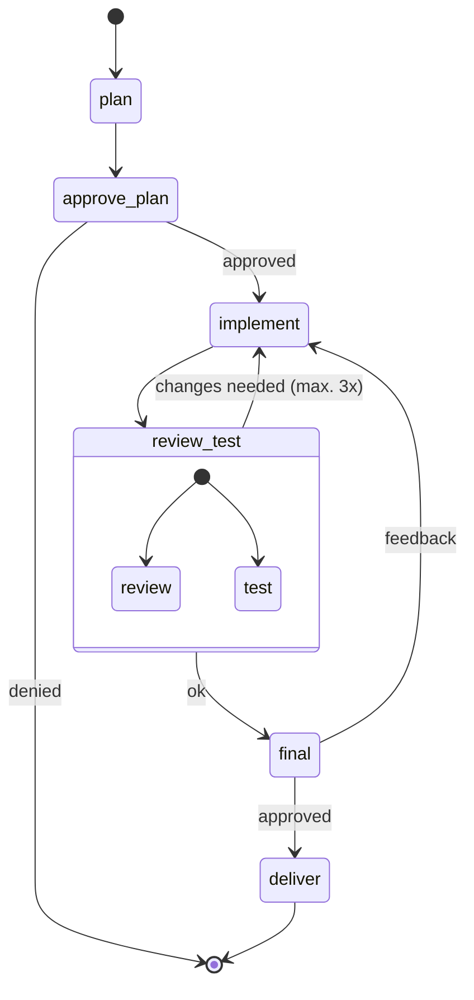

# Software factories

A **factory** chains several independent agents with clear **roles** into a pipeline, e.g.
*plan → implement → review + test → human approves → merge*. Every role can have a **different
model** and **different permissions**.

## 1. Why independent agents?

- **Fresh context:** a reviewer who did not write the implementation overlooks less.
- **Different models:** different models make different mistakes; expensive models only where
  it pays off (planning, review), cheap ones for routine work (tests, formatting).
- **Least privilege:** planners and reviewers only need read access.

## 2. Definition (`.ade/factories/<name>.yaml`)

Factories live in the repository under `.ade/factories/<name>.yaml`, prompts relative to them
(not outside `.ade/factories/`). ADE reads them from the main repository, never from a
workspace. Without an own file the built-in template of the same name applies
(`examples/factories/`). Every field is listed in the
[configuration reference](configuration.md#factory-adefactoriesnameyaml).

Scope in **M9**: linear steps with `role`, `gate: human` and `action: pull_request` (as the last
step), at most one artifact per role (its last answer), inputs of type `text` (since M10 also
`branch`: the run's workspace starts from this branch, at most one per factory),
`budget.max_cost_usd` and `budget.max_duration`. Added in **M10**: structured artifacts with a
schema, conditions (`when`), loops (`goto`, `max_iterations`, `on_deny`) and parallel steps
(`parallel`), see [execution](#3-execution). Example:

```yaml
name: feature
description: Feature from issue/prompt to PR
inputs:
  task: { type: text, required: true }

roles:
  planner:
    adapter: claude
    model: opus            # alias, resolved through the provider configuration
    permissions: read
    prompt: prompts/planner.md
    outputs: [plan.md]

  implementer:
    adapter: claude
    model: sonnet
    permissions: write
    prompt: prompts/implementer.md
    inputs: [plan.md]

  reviewer:
    adapter: codex
    model: gpt-default
    permissions: read
    prompt: prompts/reviewer.md
    outputs:                 # { "verdict": "approve" | "changes", "comments": [...] }
      - { name: review.json, schema: schemas/review.json }

  tester:
    adapter: claude
    model: haiku
    permissions: write
    prompt: prompts/tester.md
    outputs: [test-report.json]

flow:
  - step: plan
    role: planner
  - step: approve-plan
    gate: human               # optional: approve the plan first
  - step: implement
    role: implementer
  - parallel:
      - { step: review, role: reviewer }
      - { step: test,   role: tester }
  - step: decide
    when: "review.verdict == 'changes' || test.failed > 0"
    goto: implement           # loop with feedback
    max_iterations: 3
  - step: final
    gate: human
    on_deny: { goto: implement }   # denying with a reason = feedback
  - step: deliver
    action: pull_request

budget:
  max_cost_usd: 5.00
  max_duration: 2h
```

## 3. Execution



- A **run** is a state machine in SQLite (`runs`, `run_steps`); the definition is stored at
  start. After a restart the daemon continues: interrupted sessions via resume, open gates with a
  new approval.
- Every step with `role` starts a **normal agent session** – everything about dashboard, sandbox,
  IDE, approvals and costs applies unchanged. The step is done when the agent finishes its turn;
  if the session ends with an error or is stopped, the run fails.
- All roles of a run work in the **same workspace** (one branch). Sandbox or not is chosen at
  start for the whole run.
- **Read-only roles** (`permissions: read`) cannot change the workspace: in the sandbox they run
  in a second container with `/workspace` mounted read-only (same network, same egress proxy).
  Without a sandbox they work in a snapshot (clone of the workspace state with the base branch)
  that is deleted afterwards; Claude Code gets no `Edit`/`Write` there, Codex runs with
  `--sandbox read-only`. Only the sandbox offers real protection.
- **Artifacts:** a role's last answer becomes its artifact (`outputs`, e.g. `plan.md`). ADE stores
  it outside the workspace (`<data_dir>/runs/<run-id>/`), so it neither ends up in the branch nor
  can be changed by a later role, and passes it in the prompt to the roles that list it under
  `inputs`. All artifacts are shown in the dashboard and in the PR description.
- **Structured artifacts** (since M10): if an artifact ends in `.json`, the last answer must be
  JSON (the whole answer or the last ```` ```json ```` block). With
  `outputs: [{ name: review.json, schema: schemas/review.json }]` ADE also checks it against a
  schema (JSON or YAML, relative to the factory). A subset of JSON Schema is supported: `type`,
  `properties`, `required`, `enum`, `items`, `additionalProperties` (only `true`/`false`),
  `minimum`/`maximum`, `minLength`/`maxLength`, `minItems`/`maxItems`; ADE rejects other
  keywords when loading. The schema is part of the role's prompt. If the answer is invalid, the
  role gets the errors as a follow-up instruction and may correct twice; after that the step
  fails. The cleaned-up JSON is stored.
- **Gates** (`gate: human`) create an approval (kind `gate`, valid for 7 days); the run waits. A
  reason given when approving goes to the following roles as a note, "Deny" cancels the run. With
  `on_deny: { goto: implement }` the gate jumps back instead when denied; the reason is then
  required (the button is called "Back to implement") and is part of the next pass's prompt.
- **Pull request** (`action: pull_request`, last step): the daemon pushes the branch with the
  user's credentials and opens a PR. Workflows from a branch of the same repository run there
  with the repository's secrets, so a human must see the state beforehand (#103): before
  `pull_request` there must be a gate without `when`, after which no role with write permission
  runs (read-only roles and decisions are allowed; loops lead through the gate again). Otherwise
  ADE rejects the factory when loading. Whoever deliberately wants to deliver without a gate
  writes `unattended: true` on the action. Even then the run waits for an approval before the
  push if the diff changes `.github/workflows/`, `.github/actions/` or `.ade/`; denying cancels
  the run. Gates and the workspace's review view highlight such changes.
- **Conditions** (`when`): if false on a step with `role`, `gate` or `action`, the step is
  skipped. Paths start with the name of an earlier step and read fields from its structured
  artifact (`review.verdict`, `test.suite.failed`); missing fields are `null`. Allowed are strings
  (`'…'`), numbers, `true`/`false`/`null`, `== != < <= > >=`, `&& || !`, parentheses and
  `len(x)`. When loading, ADE checks that every path names an earlier step with a structured
  artifact and, if its schema lists fields, an existing field.
- **Parallel steps** (`parallel`): 2 to 8 role steps run at the same time; the group is done when
  all are done (or skipped by `when`). If one fails, ADE stops the others and the run fails.
  Because all work in the same workspace, at most one role of the group may have write
  permission; read-only roles run next to it in their reader container or snapshot. A group has
  no name and no condition of its own; a jump back to one of its members restarts the whole
  group. Members of a group do not see each other's artifacts (only the steps after it do). The
  remaining budget is split among the members at start; the time limit counts the time in which
  at least one role is working.
- **Loops:** a decision `{ step: decide, when: "…", goto: implement }` jumps back if the
  condition is true, otherwise it continues. A jump back creates a new pass for all steps from the
  target to the decision; earlier passes with their sessions and artifacts stay visible. In the
  new pass the roles get the latest artifacts (e.g. `review.json` with comments) and the reason
  for the jump. A role may also list an artifact as input that only a later step produces, if a
  jump from there leads back; in the first pass it is then missing. `max_iterations` (default 3,
  at most 20) limits the passes of a decision or of a gate with `on_deny`; when the limit is
  reached the run fails (decision with `on_exhausted: continue`: it continues without jumping;
  gate: the run is cancelled). The passes of the step are counted, regardless of which loop
  jumped back.
- **Budgets:** `max_cost_usd` applies to all sessions of the run together; every role starts with
  the remainder as session budget and pauses with a budget approval when it is exceeded (as in
  M8). `max_duration` limits the roles' working time (waiting at gates does not count); after
  that the run fails.

## 4. Models and providers

Roles reference **aliases** (`opus`, `sonnet`, `gpt-default`) that the global configuration maps
to specific model IDs and providers. That way factory definitions in the repository stay stable
even when models change.

```yaml
# ~/.config/ade/config.yaml
models:
  opus:        { provider: anthropic, id: <current Opus ID> }
  sonnet:      { provider: anthropic, id: <current Sonnet ID> }
  haiku:       { provider: anthropic, id: <current Haiku ID> }
  gpt-default: { provider: openai,    id: <current model ID> }
```

Optionally a **LiteLLM** gateway can be configured as a provider to bundle many providers behind
one OpenAI-compatible interface.

## 5. Triggers

| Trigger | Milestone |
|---|---|
| Manually in the dashboard (enter a prompt) | M9 |
| API / CLI (`ade run feature --task "…" [--wait]`) | M9 |
| GitHub issue with a label (polling via `gh`) | M10 |
| Schedule (e.g. a nightly dependency update run) | M10 |

Automatic triggers are configured under `triggers` in `.ade/project.yaml` (from the main
repository):

```yaml
triggers:
  - name: features                 # unique within the project
    factory: feature
    inputs: { area: backend }      # fixed inputs (with issues, task comes from the issue)
    sandbox: true                  # default: true
    allow_unbudgeted: false        # default: the factory needs budget.max_cost_usd
    github_issues:
      label: "ade:feature"
      authors: [octocat]           # optional: only issues of these users
      interval: 5m                 # polling interval (1m–24h)
      comment: true                # comment at start and end
  - name: nightly
    factory: deps
    inputs: { task: "Update dependencies" }
    schedule:
      cron: "0 3 * * 1-5"          # 5 fields or @daily, @hourly, …; system time zone
      catch_up: true               # catch up on a missed date after a pause (only the last one)
```

- **GitHub issues:** the daemon polls `gh issue list --label …` in the main repository at the
  interval (no webhook: ADE is not reachable from outside). Every open issue starts at most one
  run, also across restarts; title, URL and text become the task (`task`). ADE comments on the
  start and the end (link to the PR or error), the PR description starts with `Closes #<nr>`.
  ADE starts at most five runs per poll; a failed start (e.g. factory without a budget) is retried
  at the next poll and shown in the dashboard.
- **Schedule:** a new trigger counts from when it is first seen (nothing is caught up). If the
  daemon was off at the date, ADE only catches up on the last missed date (`catch_up: false`:
  none). If the previous run of the same trigger is still running, the date is skipped.
- **Security:** the text of an issue is untrusted input and can try to steer the agent (prompt
  injection). That is why triggered runs use the sandbox (with egress allowlist) and only run with
  a budget by default. On GitHub only users with at least triage permissions set labels; in public
  repositories still set `authors`, because anybody can open an issue that is labeled later – ADE
  checks who wrote the issue, not who set the label. Gates (`gate: human`) before the PR remain
  the most important brake; without a gate (`unattended: true`) only changes to workflows and
  `.ade/` stop the run.
- Triggers can be paused and resumed in the dashboard's project view (API:
  `POST /api/projects/{id}/triggers/{name}/pause`, `…/resume`);
  `GET /api/projects/{id}/triggers` returns the state, next poll or next date and the latest
  triggered runs. Runs carry their trigger (`trigger`, `trigger_ref`).

## 6. Templates

Factories that ship with ADE (in `examples/factories/`):

- **feature** – plan → approval → implementation → review (`review.json`) and test (`test.json`)
  in parallel → back to implementation as long as the reviewer wants changes or tests fail (at
  most three rounds, then the human decides) → approval (denying with a reason leads back to the
  implementation) → PR
- **bugfix** – reproduce: write a test that must fail (`repro.json`; without a reproduction after
  two attempts the run fails) → fix → tests → back to the fix as long as tests fail → approval →
  PR
- **review-only** – two reviewers (different models) check the branch from the input `branch`
  independently and in parallel, an aggregator summarizes (`report.md`). Changes nothing, no PR.
  The workspace has no connection to the main repository: the reviewers see the state and the
  history of the branch, no diff against `main` – what to check (commits, directory) belongs in
  the task.
- **refactor** – plan in small steps → approval → exactly one step per pass (`progress.json`) with
  a test run afterwards, until the plan is done and everything is green (at most ten passes) →
  approval → PR

Prompts are under `examples/factories/prompts/`, schemas under `examples/factories/schemas/`. An
own factory with the same name in `.ade/factories/` replaces the template; its prompts and schemas
must then be there as well. The templates only use the adapter `claude` (models `opus`, `sonnet`,
`haiku`); for a second model from another provider, e.g. a reviewer can be switched to
`adapter: codex`.
