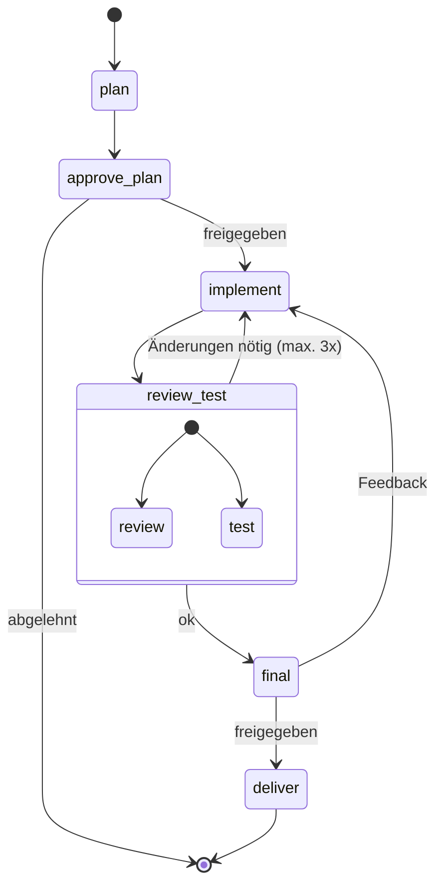

# Software-Fabriken

Eine **Fabrik** verkettet mehrere unabhängige Agenten mit klaren **Rollen** zu einer Pipeline,
z. B. *planen → implementieren → reviewen + testen → Mensch gibt frei → mergen*.
Jede Rolle kann ein **anderes Modell** und **andere Rechte** haben.

## 1. Warum unabhängige Agenten?

- **Frischer Kontext:** Ein Reviewer, der die Implementierung nicht selbst geschrieben hat,
  übersieht weniger.
- **Verschiedene Modelle:** Unterschiedliche Modelle machen unterschiedliche Fehler; teure Modelle
  nur dort, wo es sich lohnt (Planung, Review), günstige für Routine (Tests, Formatierung).
- **Minimale Rechte:** Planer und Reviewer brauchen nur Lesezugriff.

## 2. Definition (`.ade/factories/<name>.yaml`)

Fabriken liegen im Repo unter `.ade/factories/<name>.yaml`, Prompts relativ dazu (nicht
außerhalb von `.ade/factories/`). ADE liest sie aus dem Haupt-Repo, nie aus einem Workspace.
Ohne eigene Datei gilt die gleichnamige mitgelieferte Vorlage (`examples/factories/`).

Umfang in **M9**: lineare Schritte mit `role`, `gate: human` und `action: pull_request` (als
letzter Schritt), je Rolle höchstens ein Artefakt (ihre letzte Antwort), Eingaben vom Typ `text`,
`budget.max_cost_usd` und `budget.max_duration`. Seit **M10** dazu: strukturierte Artefakte mit
Schema, Bedingungen (`when`), Schleifen (`goto`, `max_iterations`, `on_deny`) und parallele
Schritte (`parallel`), siehe [Ausführung](#3-ausführung). Beispiel:

```yaml
name: feature
description: Feature von Issue/Prompt bis zum PR
inputs:
  task: { type: text, required: true }

roles:
  planner:
    adapter: claude
    model: opus            # Alias, aufgelöst über Provider-Konfiguration
    permissions: read
    prompt: prompts/planner.md
    outputs: [plan.md]

  implementer:
    adapter: claude
    model: sonnet
    permissions: write
    prompt: prompts/implementer.md
    inputs: [plan.md]

  reviewer:
    adapter: codex
    model: gpt-default
    permissions: read
    prompt: prompts/reviewer.md
    outputs:                 # { "verdict": "approve" | "changes", "comments": [...] }
      - { name: review.json, schema: schemas/review.json }

  tester:
    adapter: claude
    model: haiku
    permissions: write
    prompt: prompts/tester.md
    outputs: [test-report.json]

flow:
  - step: plan
    role: planner
  - step: approve-plan
    gate: human               # optional: Plan erst freigeben
  - step: implement
    role: implementer
  - parallel:
      - { step: review, role: reviewer }
      - { step: test,   role: tester }
  - step: decide
    when: "review.verdict == 'changes' || test.failed > 0"
    goto: implement           # Schleife mit Feedback
    max_iterations: 3
  - step: final
    gate: human
    on_deny: { goto: implement }   # Ablehnen mit Begründung = Feedback
  - step: deliver
    action: pull_request

budget:
  max_cost_usd: 5.00
  max_duration: 2h
```

## 3. Ausführung



- Ein **Run** ist eine Zustandsmaschine in SQLite (`runs`, `run_steps`); die Definition wird
  beim Start gespeichert. Nach einem Neustart setzt der Daemon fort: unterbrochene Sessions über
  Resume, offene Gates mit einer neuen Freigabe.
- Jeder Schritt mit `role` startet eine **normale Agent-Session** – alles aus Dashboard,
  Sandbox, IDE, Freigaben und Kosten gilt unverändert. Der Schritt ist fertig, wenn der Agent
  seine Runde beendet; endet die Session mit Fehler oder wird gestoppt, scheitert der Run.
- Alle Rollen eines Runs arbeiten im **selben Workspace** (ein Branch). Sandbox oder nicht
  wählt man beim Start für den ganzen Run.
- **Lese-Rollen** (`permissions: read`) können den Workspace nicht ändern: In der Sandbox laufen
  sie in einem zweiten Container mit `/workspace` nur lesend gemountet (gleiches Netz, gleicher
  Egress-Proxy). Ohne Sandbox arbeiten sie in einem Schnappschuss (Klon des Workspace-Stands mit
  Basis-Branch), der danach gelöscht wird; Claude Code bekommt dort kein `Edit`/`Write`, Codex
  läuft mit `--sandbox read-only`. Echten Schutz bietet nur die Sandbox.
- **Artefakte:** Die letzte Antwort einer Rolle wird ihr Artefakt (`outputs`, z. B. `plan.md`).
  ADE speichert es außerhalb des Workspaces (`<data_dir>/runs/<run-id>/`), damit es weder im
  Branch landet noch von einer späteren Rolle verändert werden kann, und gibt es den Rollen, die
  es unter `inputs` nennen, im Prompt mit. Im Dashboard und in der PR-Beschreibung sind alle
  Artefakte zu sehen.
- **Strukturierte Artefakte** (ab M10): Endet ein Artefakt auf `.json`, muss die letzte Antwort
  JSON sein (die ganze Antwort oder der letzte ```` ```json ````-Block). Mit
  `outputs: [{ name: review.json, schema: schemas/review.json }]` prüft ADE es zusätzlich gegen
  ein Schema (JSON oder YAML, relativ zur Fabrik). Unterstützt wird eine Teilmenge von JSON
  Schema: `type`, `properties`, `required`, `enum`, `items`, `additionalProperties` (nur
  `true`/`false`), `minimum`/`maximum`, `minLength`/`maxLength`, `minItems`/`maxItems`; andere
  Schlüsselwörter lehnt ADE beim Laden ab. Das Schema steht im Prompt der Rolle. Ist die
  Antwort ungültig, bekommt die Rolle die Fehler als Folgeanweisung und darf zweimal
  korrigieren, danach scheitert der Schritt. Gespeichert wird das bereinigte JSON.
- **Gates** (`gate: human`) erzeugen eine Freigabe (Art `gate`, 7 Tage gültig); der Run wartet.
  Eine Begründung beim Freigeben geht als Hinweis an die folgenden Rollen, „Ablehnen“ bricht den
  Run ab. Mit `on_deny: { goto: implement }` springt das Gate beim Ablehnen stattdessen zurück;
  die Begründung steht im Prompt des nächsten Durchlaufs.
- **Bedingungen** (`when`): Ist sie an einem Schritt mit `role`, `gate` oder `action` falsch,
  wird der Schritt übersprungen. Pfade beginnen mit dem Namen eines früheren Schritts und lesen
  Felder aus seinem strukturierten Artefakt (`review.verdict`, `test.suite.failed`); fehlende
  Felder sind `null`. Erlaubt sind Zeichenketten (`'…'`), Zahlen, `true`/`false`/`null`,
  `== != < <= > >=`, `&& || !`, Klammern und `len(x)`. ADE prüft beim Laden, dass jeder Pfad
  einen früheren Schritt mit strukturiertem Artefakt nennt und, wenn dessen Schema Felder
  aufzählt, ein vorhandenes Feld.
- **Parallele Schritte** (`parallel`): 2 bis 8 Rollen-Schritte laufen gleichzeitig; die Gruppe
  ist fertig, wenn alle fertig (oder per `when` übersprungen) sind. Scheitert einer, stoppt ADE
  die anderen und der Run scheitert. Weil alle im selben Workspace arbeiten, darf höchstens eine
  Rolle der Gruppe Schreibrechte haben; Lese-Rollen laufen in ihrem Lese-Container bzw.
  Schnappschuss neben ihr. Eine Gruppe hat keinen eigenen Namen und keine Bedingung; ein
  Rücksprung auf eines ihrer Mitglieder startet die ganze Gruppe neu. Mitglieder einer Gruppe
  sehen ihre Artefakte gegenseitig nicht (erst die Schritte danach). Das Rest-Budget wird beim
  Start auf die Mitglieder aufgeteilt; das Zeitlimit zählt die Zeit, in der mindestens eine
  Rolle arbeitet.
- **Schleifen:** Eine Entscheidung `{ step: decide, when: "…", goto: implement }` springt zurück,
  wenn die Bedingung wahr ist, sonst geht es weiter. Ein Rücksprung legt für alle Schritte vom
  Ziel bis zur Entscheidung einen neuen Durchlauf an; frühere Durchläufe mit ihren Sessions und
  Artefakten bleiben sichtbar. Im neuen Durchlauf bekommen die Rollen die jüngsten Artefakte
  (z. B. `review.json` mit Kommentaren) und den Grund des Rücksprungs. Eine Rolle darf auch ein
  Artefakt als Eingabe nennen, das erst ein späterer Schritt erzeugt, wenn ein Rücksprung von
  dort zurückführt; im ersten Durchlauf fehlt es dann. `max_iterations` (Standard 3, höchstens
  20) begrenzt die Durchläufe einer Entscheidung bzw. eines Gates mit `on_deny`; ist die Grenze
  erreicht, scheitert der Run (Entscheidung mit `on_exhausted: continue`: es geht ohne
  Rücksprung weiter; Gate: der Run wird abgebrochen). Gezählt werden die Durchläufe des
  Schritts, gleich welche Schleife zurückgesprungen ist.
- **Budgets:** `max_cost_usd` gilt für alle Sessions des Runs zusammen; jede Rolle startet mit dem
  Rest als Session-Budget und pausiert bei Überschreitung mit Budget-Freigabe (wie in M8).
  `max_duration` begrenzt die Arbeitszeit der Rollen (Warten an Gates zählt nicht); danach
  scheitert der Run.

## 4. Modelle und Anbieter

Rollen referenzieren **Aliase** (`opus`, `sonnet`, `gpt-default`), die in der globalen
Konfiguration auf konkrete Modell-IDs und Anbieter abgebildet werden. So bleiben
Fabrik-Definitionen im Repo stabil, auch wenn Modelle wechseln.

```yaml
# ~/.config/ade/config.yaml
models:
  opus:        { provider: anthropic, id: <aktuelle Opus-ID> }
  sonnet:      { provider: anthropic, id: <aktuelle Sonnet-ID> }
  haiku:       { provider: anthropic, id: <aktuelle Haiku-ID> }
  gpt-default: { provider: openai,    id: <aktuelle Modell-ID> }
```

Optional kann ein **LiteLLM**-Gateway als Provider eingetragen werden, um viele Anbieter über
eine OpenAI-kompatible Schnittstelle zu bündeln.

## 5. Auslöser

| Auslöser | Meilenstein |
|---|---|
| Manuell im Dashboard (Prompt eingeben) | M9 |
| API / CLI (`ade run feature --task "…" [--wait]`) | M9 |
| GitHub-Issue mit Label (Polling über `gh`) | M10 |
| Zeitplan (z. B. nächtlicher Dependency-Update-Run) | M10 |

Automatische Auslöser stehen unter `triggers` in `.ade/project.yaml` (aus dem Haupt-Repo):

```yaml
triggers:
  - name: features                 # eindeutig im Projekt
    factory: feature
    inputs: { area: backend }      # feste Eingaben (task kommt bei Issues aus dem Issue)
    sandbox: true                  # Standard: true
    allow_unbudgeted: false        # Standard: Fabrik braucht budget.max_cost_usd
    github_issues:
      label: "ade:feature"
      authors: [octocat]           # optional: nur Issues dieser Nutzer
      interval: 5m                 # Abstand der Abfragen (1m–24h)
      comment: true                # Kommentar bei Start und Ende
  - name: nightly
    factory: deps
    inputs: { task: "Abhängigkeiten aktualisieren" }
    schedule:
      cron: "0 3 * * 1-5"          # 5 Felder oder @daily, @hourly, …; Zeitzone des Systems
      catch_up: true               # verpassten Termin nach einer Pause nachholen (nur den letzten)
```

- **GitHub-Issues:** Der Daemon fragt im Takt `gh issue list --label …` im Haupt-Repo ab (kein
  Webhook: ADE ist von außen nicht erreichbar). Jedes offene Issue startet höchstens einen Run,
  auch über Neustarts hinweg; Titel, URL und Text werden die Aufgabe (`task`). ADE kommentiert
  den Start und das Ende (Link zum PR oder Fehler), die PR-Beschreibung beginnt mit
  `Closes #<nr>`. Je Abfrage startet ADE höchstens fünf Runs; ein gescheiterter Start (z. B.
  Fabrik ohne Budget) wird bei der nächsten Abfrage erneut versucht und im Dashboard angezeigt.
- **Zeitplan:** Ein neuer Auslöser zählt ab dem ersten Sehen (nichts wird nachgeholt). War der
  Daemon zum Termin aus, holt ADE nur den letzten verpassten Termin nach (`catch_up: false`:
  keinen). Läuft der vorige Run desselben Auslösers noch, fällt der Termin aus.
- **Sicherheit:** Der Text eines Issues ist fremde Eingabe und kann versuchen, den Agenten zu
  steuern (Prompt-Injection). Deshalb laufen ausgelöste Runs standardmäßig in der Sandbox (mit
  Egress-Allowlist) und nur mit Budget. Labels setzen auf GitHub nur Nutzer mit mindestens
  Triage-Rechten; in öffentlichen Repos trotzdem `authors` angeben, denn jeder kann ein Issue
  eröffnen, das später gelabelt wird – geprüft wird, wer das Issue geschrieben hat, nicht wer
  das Label gesetzt hat. Gates (`gate: human`) vor dem PR bleiben die wichtigste Bremse.
- Auslöser lassen sich pausieren (`POST /api/projects/{id}/triggers/{name}/pause`, `…/resume`);
  `GET /api/projects/{id}/triggers` liefert Zustand, nächste Abfrage bzw. nächsten Termin und
  die zuletzt ausgelösten Runs. Runs tragen ihren Auslöser (`trigger`, `trigger_ref`).

## 6. Vorlagen

Mitgelieferte Fabriken (in `examples/factories/`):

- **feature** – Plan → Freigabe → Implementierung → Review → Freigabe → PR (ab M9; Review/Test
  parallel und Rücksprung ab M10)
- **bugfix** – Reproduzieren (Test schreiben, muss fehlschlagen) → Fix → Test grün → PR
- **review-only** – Mehrere Reviewer-Modelle prüfen einen bestehenden Branch/PR parallel,
  ein Aggregator fasst zusammen
- **refactor** – Plan mit Gate, dann schrittweise Umsetzung mit Test nach jedem Schritt
