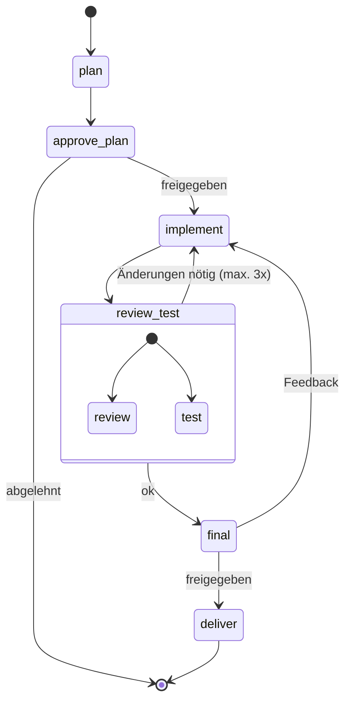

# Software-Fabriken

Eine **Fabrik** verkettet mehrere unabhängige Agenten mit klaren **Rollen** zu einer Pipeline,
z. B. *planen → implementieren → reviewen + testen → Mensch gibt frei → mergen*.
Jede Rolle kann ein **anderes Modell** und **andere Rechte** haben.

## 1. Warum unabhängige Agenten?

- **Frischer Kontext:** Ein Reviewer, der die Implementierung nicht selbst geschrieben hat,
  übersieht weniger.
- **Verschiedene Modelle:** Unterschiedliche Modelle machen unterschiedliche Fehler; teure Modelle
  nur dort, wo es sich lohnt (Planung, Review), günstige für Routine (Tests, Formatierung).
- **Minimale Rechte:** Planer und Reviewer brauchen nur Lesezugriff.

## 2. Definition (`.ade/factories/<name>.yaml`)

```yaml
name: feature
description: Feature von Issue/Prompt bis zum PR
inputs:
  task: { type: text, required: true }

roles:
  planner:
    adapter: claude
    model: opus            # Alias, aufgelöst über Provider-Konfiguration
    permissions: read
    prompt: prompts/planner.md
    outputs: [plan.md]

  implementer:
    adapter: claude
    model: sonnet
    permissions: write
    sandbox: default
    prompt: prompts/implementer.md
    inputs: [plan.md]

  reviewer:
    adapter: codex
    model: gpt-default
    permissions: read
    prompt: prompts/reviewer.md
    outputs: [review.json]   # { "verdict": "approve" | "changes", "comments": [...] }

  tester:
    adapter: claude
    model: haiku
    permissions: write
    prompt: prompts/tester.md
    outputs: [test-report.json]

flow:
  - step: plan
    role: planner
  - step: approve-plan
    gate: human               # optional: Plan erst freigeben
  - step: implement
    role: implementer
  - parallel:
      - { step: review, role: reviewer }
      - { step: test,   role: tester }
  - step: decide
    when: "review.verdict == 'changes' || test.failed > 0"
    goto: implement           # Schleife mit Feedback
    max_iterations: 3
  - step: final
    gate: human
  - step: deliver
    action: pull_request

budget:
  max_cost_usd: 5.00
  max_duration: 2h
```

## 3. Ausführung



- Ein **Run** ist eine Zustandsmaschine in SQLite; der Daemon kann nach Neustart fortsetzen.
- Jeder Schritt mit `role` startet eine **normale Agent-Session** – alles aus Dashboard,
  Sandbox, IDE und Freigaben gilt unverändert.
- Alle Rollen eines Runs arbeiten im **selben Workspace** (ein Branch), Lese-Rollen bekommen
  ihn read-only gemountet.
- **Artefakte** liegen unter `.ade/runs/<run-id>/` im Workspace (`plan.md`, `review.json`, …)
  und werden der nächsten Rolle im Prompt referenziert. Strukturierte Artefakte (JSON) haben ein
  Schema; der Daemon validiert sie, bevor `when`-Bedingungen ausgewertet werden.
- **Gates** (`gate: human`) erzeugen eine Freigabe im Dashboard; der Run wartet.
- **Budgets** werden vom Proxy (Tokens) und Daemon (Zeit) überwacht; bei Überschreitung pausiert
  der Run mit Freigabe-Anfrage.

## 4. Modelle und Anbieter

Rollen referenzieren **Aliase** (`opus`, `sonnet`, `gpt-default`), die in der globalen
Konfiguration auf konkrete Modell-IDs und Anbieter abgebildet werden. So bleiben
Fabrik-Definitionen im Repo stabil, auch wenn Modelle wechseln.

```yaml
# ~/.config/ade/config.yaml
models:
  opus:        { provider: anthropic, id: <aktuelle Opus-ID> }
  sonnet:      { provider: anthropic, id: <aktuelle Sonnet-ID> }
  haiku:       { provider: anthropic, id: <aktuelle Haiku-ID> }
  gpt-default: { provider: openai,    id: <aktuelle Modell-ID> }
```

Optional kann ein **LiteLLM**-Gateway als Provider eingetragen werden, um viele Anbieter über
eine OpenAI-kompatible Schnittstelle zu bündeln.

## 5. Auslöser

| Auslöser | Meilenstein |
|---|---|
| Manuell im Dashboard (Prompt eingeben) | M9 |
| API / CLI (`ade run feature --task "…"`) | M9 |
| GitHub-Issue mit Label (Polling oder Webhook) | M10 |
| Zeitplan (z. B. nächtlicher Dependency-Update-Run) | M10 |

## 6. Vorlagen

Mitgelieferte Fabriken (in `examples/factories/`):

- **feature** – Plan → Implementierung → Review/Test → PR (oben)
- **bugfix** – Reproduzieren (Test schreiben, muss fehlschlagen) → Fix → Test grün → PR
- **review-only** – Mehrere Reviewer-Modelle prüfen einen bestehenden Branch/PR parallel,
  ein Aggregator fasst zusammen
- **refactor** – Plan mit Gate, dann schrittweise Umsetzung mit Test nach jedem Schritt
