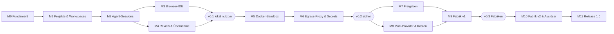

# Meilensteine

Jeder Meilenstein liefert etwas **Benutzbares** und baut auf dem vorherigen auf.
Pro Meilenstein: Ziel, Umfang, Akzeptanzkriterien und bewusst **nicht** enthaltene Punkte.

---

## M0 – Fundament

**Ziel:** Leeres, aber sauberes Projekt, das baut, testet und startet.

- Go-Modul `github.com/DavidW475/ade`, Struktur laut [architecture.md](architecture.md#10-repo-struktur)
- `ade serve`: HTTP-Server auf `127.0.0.1:7000`, `GET /api/health`
- Konfiguration laden (`~/.config/ade/config.yaml`, Defaults wenn nicht vorhanden)
- SQLite-Store mit Migrationsmechanismus (erste Tabelle: `projects`)
- Frontend-Gerüst (Vite + React + TS), per `go:embed` ausgeliefert, zeigt „ADE läuft“
- Auth: Einmal-Token beim Start → Cookie; `Host`/`Origin`-Prüfung
- `ade start`: Daemon starten (falls nötig) und Browser unter Windows öffnen (`wslview`/`explorer.exe`)
- GitHub Actions: Lint, Test, Build; `LICENSE` (Apache-2.0), `README.md`, `CONTRIBUTING.md`

**Fertig, wenn:**
- [x] `make build` erzeugt ein einzelnes Binary mit eingebettetem Frontend
- [x] `ade start` öffnet das Dashboard im Windows-Browser
- [x] Anfragen mit fremdem `Host`-Header werden abgelehnt
- [x] CI ist grün

**Nicht dabei:** Agenten, Docker.

---

## M1 – Projekte & Workspaces

**Ziel:** Repos registrieren und isolierte Arbeitskopien anlegen.

- `ade project add <pfad>` und im Dashboard; Warnung bei Pfaden unter `/mnt/*`
- `.ade/project.yaml` lesen (Basis-Branch, Setup-Befehle)
- Workspace anlegen: `git clone --local` nach `~/.ade/workspaces/<id>`, Branch `ade/<id>`,
  `base_commit` speichern
- Workspace-Liste pro Projekt, Status, Löschen
- Diff-Endpunkt `GET /api/workspaces/{id}/diff` (Dateiliste + Patches)

**Fertig, wenn:**
- [x] Ein Repo lässt sich registrieren und erscheint im Dashboard
- [x] Workspaces lassen sich anlegen und löschen, ohne das Haupt-Repo zu verändern
- [x] Manuelle Änderungen im Workspace erscheinen im Diff-Endpunkt

**Nicht dabei:** Agenten, Merge.

---

## M2 – Agent-Sessions (lokal)

**Ziel:** Einen Agenten im Workspace starten und live zusehen.

- Adapter-Interface; Adapter `pty` (beliebiger Befehl) und `claude` (`stream-json`)
- Prozess mit PTY im Workspace-Verzeichnis, Umgebung kontrolliert
- Events normalisieren, in SQLite speichern, per WebSocket streamen (mit Replay ab `seq`)
- Dashboard: Agent starten (Projekt, Aufgabe, Adapter), Timeline, Live-Terminal (xterm.js),
  Folgeanweisung senden, Stoppen
- Daemon-Neustart: laufende Sessions als „unterbrochen“ markieren, Fortsetzen falls die CLI es kann

**Fertig, wenn:**
- [x] Claude Code löst eine kleine Aufgabe im Workspace; Tool-Aufrufe erscheinen live in der Timeline
- [x] Browser schließen und wieder öffnen zeigt die vollständige Historie
- [x] Ein interaktives Terminal (`pty`-Adapter mit `bash`) funktioniert im Browser

**Nicht dabei:** Sandbox, IDE, Freigaben.

---

## M3 – Browser-IDE

**Ziel:** Aus dem Dashboard in den Workspace eines Agenten „hineinspringen“.

- openvscode-server als lokaler Prozess pro Workspace (bei Bedarf starten, bei Inaktivität stoppen)
- Gateway: `ws-<id>.localhost:7000` → IDE-Port, inkl. WebSocket, Token-Weitergabe
- Button „IDE öffnen“ in Agent- und Workspace-Ansicht
- Open VSX als Extension-Quelle konfiguriert

**Fertig, wenn:**
- [x] Klick auf „IDE öffnen“ zeigt den Workspace mit Dateibaum, Editor und Terminal
- [x] Änderungen des Agenten erscheinen live in der IDE
- [x] Die IDE ist ohne gültige ADE-Session nicht erreichbar

**Nicht dabei:** IDE im Container (kommt mit M5).

---

## M4 – Review & Übernahme

**Ziel:** Ergebnis eines Agenten prüfen und übernehmen. → **Release v0.1**

- Diff-Ansicht im Dashboard (Monaco Diff Editor), Dateiliste
- Aktionen: **Mergen** (lokal in Basis-Branch), **PR erstellen** (Push + `gh pr create` vom Host),
  **Feedback** (neue Session im selben Workspace mit Kommentar), **Verwerfen**
- Automatischer WIP-Commit am Session-Ende; Branch per `fetch` ins Haupt-Repo

**Fertig, wenn:**
- [ ] Kompletter Ablauf: Aufgabe → Agent → Diff ansehen → PR auf GitHub
- [x] Feedback-Schleife erzeugt einen zweiten Commit im selben Branch
- [x] Verwerfen entfernt Workspace und Branch rückstandsfrei

**v0.1:** README mit Installationsanleitung, erstes GitHub-Release (Binary für linux/amd64).

---

## M5 – Docker-Sandbox

**Ziel:** Agent und IDE laufen isoliert im Container. Details: [sandbox.md](sandbox.md).

- Image `ade-agent-base` (Dockerfile in `images/agent-base`, CI baut und pusht nach GHCR)
- Pro Workspace: Container mit Mount `/workspace`, Non-Root, `cap-drop ALL`, Limits
- Agent-Sessions über `docker exec` mit PTY; openvscode-server im Container, Gateway zeigt darauf
- `.ade/sandbox.yaml`: Image, Ressourcen; Schalter „Sandbox“ beim Agent-Start
- Labels + `ade gc`; Abgleich nach Daemon-Neustart

**Fertig, wenn:**
- [x] Agent-Start mit Sandbox: Agent und IDE laufen im Container, Ergebnis landet im Workspace
- [x] Der Container sieht weder das Haupt-Repo noch `$HOME` des Nutzers
- [x] `ade gc` entfernt verwaiste Container

**Nicht dabei:** Netzwerk-Einschränkung (Container hat in M5 noch normales Netz – im UI kennzeichnen).

---

## M6 – Egress-Proxy & Secrets

**Ziel:** Sandbox darf nur in freigegebene Ziele; keine Secrets im Container. → **Release v0.2**

- Internes Netz pro Workspace + Proxy-Container (`ade proxy`)
- Allowlist (Presets + eigene Einträge), Hot-Reload der Policy
- Egress-Events → Dashboard-Ansicht „Netzwerk“ (erlaubt/geblockt)
- Secret-Injection über Basis-URLs (`/p/<provider>/…`), zuerst für Anthropic
- DNS-Verhalten prüfen und absichern

**Fertig, wenn:**
- [x] `curl https://example.com` im Container schlägt fehl, `curl https://registry.npmjs.org` (Preset `npm`) klappt
- [ ] Claude Code arbeitet in der Sandbox, ohne dass der API-Key im Container lesbar ist (`env`, Dateien)
- [x] Ein Programm, das `HTTP_PROXY` ignoriert, erreicht das Internet nicht

---

## M7 – Freigaben & Policies

**Ziel:** Der Mensch entscheidet über kritische Aktionen – zentral und asynchron.

- Freigabe-Service + Warteschlange im Dashboard (mit Badge/Browser-Benachrichtigung)
- `ade hook pretooluse` für Claude Code; Aufruf über Proxy an den Daemon, blockierend mit Timeout
- Freigabe bei geblockter Domain („einmal / immer / ablehnen“) → Policy wird aktualisiert
- Regeln pro Projekt: welche Tools/Befehle ohne Rückfrage erlaubt sind (getrennt für Sandbox/lokal)

**Fertig, wenn:**
- [x] Ein Agent wartet auf Freigabe, der Nutzer bestätigt im Browser, der Agent macht weiter
- [x] Eine geblockte Domain kann mit einem Klick dauerhaft erlaubt werden

---

## M8 – Multi-Provider & Kosten

**Ziel:** Mehrere Agent-CLIs und Modelle; volle Kostenkontrolle.

- Adapter `codex` (und ggf. weitere); Modell-Aliase in der Konfiguration
- Proxy zählt Tokens pro Workspace/Session (aus API-Antworten), Kosten im Dashboard
- Budgets pro Session/Projekt mit Pause + Freigabe bei Überschreitung
- Optional: LiteLLM als Provider

**Fertig, wenn:**
- [x] Zwei verschiedene Agent-CLIs laufen parallel in getrennten Sandboxen
- [x] Kosten pro Session werden angezeigt und ein Budget stoppt einen Agenten

---

## M9 – Software-Fabrik v1

**Ziel:** Mehrere Rollen-Agenten als Pipeline. Details: [factory.md](factory.md). → **Release v0.3**

- Fabrik-YAML laden und validieren; lineare Schritte, `gate: human`, Artefakte
- Run-Zustandsmaschine in SQLite, Fortsetzen nach Neustart
- Lese-Rollen mit read-only Mount
- Dashboard: Runs, Pipeline-Ansicht, aktuelle Rolle, Artefakte ansehen
- `ade run <fabrik> --task "…"`
- Vorlage `feature`

**Fertig, wenn:**
- [x] `feature`-Fabrik: Planer → (Gate) → Entwickler → Reviewer → (Gate) → PR läuft durch
- [x] Planer/Reviewer können keine Dateien im Workspace ändern

---

## M10 – Fabrik v2 & Auslöser

- Parallele Schritte, Bedingungen (`when`), Schleifen mit `max_iterations`
- Strukturierte Artefakte mit Schema-Validierung
- Auslöser: GitHub-Issues mit Label, Zeitplan
- Vorlagen `bugfix`, `review-only`, `refactor`

**Fertig, wenn:**
- [x] Reviewer lehnt ab → Entwickler bekommt Kommentare → zweiter Durchlauf → Freigabe
- [x] Ein gelabeltes GitHub-Issue startet automatisch einen Run und endet als PR

---

## M11 – Release 1.0

- Installationsskript, `ade install-service` (systemd user service in WSL)
- Rootless Docker / Podman getestet
- Sicherheitsreview (Gateway, Proxy, Container-Härtung), Threat-Model-Dokument
- Doku: Nutzerhandbuch, Konfigurationsreferenz, Adapter schreiben (Contributor-Guide)
- Releases via GoReleaser, Images versioniert in GHCR

---

## Spätere Ideen (Backlog)

- TLS-Interception im Proxy für Regeln auf Pfad-/Methodenebene
- Wegwerf-WSL-Distros als alternative Sandbox (`wsl --import`)
- Gemeinsames Gedächtnis / Projektwissen über Sessions hinweg
- MCP-Hub: MCP-Server zentral verwalten und pro Rolle freigeben
- Mobile-Ansicht für Freigaben unterwegs
- Mehrbenutzerbetrieb / Team-Server
