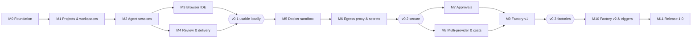

# Milestones

Every milestone delivers something **usable** and builds on the previous one.
Per milestone: goal, scope, acceptance criteria and points deliberately **not** included.

---

## M0 – Foundation

**Goal:** an empty but clean project that builds, tests and starts.

- Go module `github.com/DavidW475/ade`, structure as in [architecture.md](architecture.md#10-repository-layout)
- `ade serve`: HTTP server on `127.0.0.1:7000`, `GET /api/health`
- Load the configuration (`~/.config/ade/config.yaml`, defaults if missing)
- SQLite store with a migration mechanism (first table: `projects`)
- Frontend scaffold (Vite + React + TS), served via `go:embed`, shows "ADE is running"
- Auth: one-time token at start → cookie; `Host`/`Origin` check
- `ade start`: start the daemon (if needed) and open the browser on Windows (`wslview`/`explorer.exe`)
- GitHub Actions: lint, test, build; `LICENSE` (Apache-2.0), `README.md`, `CONTRIBUTING.md`

**Done when:**
- [x] `make build` produces a single binary with an embedded frontend
- [x] `ade start` opens the dashboard in the Windows browser
- [x] Requests with a foreign `Host` header are rejected
- [x] CI is green

**Not included:** agents, Docker.

---

## M1 – Projects & workspaces

**Goal:** register repositories and create isolated working copies.

- `ade project add <path>` and in the dashboard; warning for paths under `/mnt/*`
- Read `.ade/project.yaml` (base branch, setup commands)
- Create a workspace: `git clone --local` to `~/.ade/workspaces/<id>`, branch `ade/<id>`,
  store `base_commit`
- Workspace list per project, status, deletion
- Diff endpoint `GET /api/workspaces/{id}/diff` (file list + patches)

**Done when:**
- [x] A repository can be registered and appears in the dashboard
- [x] Workspaces can be created and deleted without changing the main repository
- [x] Manual changes in the workspace appear in the diff endpoint

**Not included:** agents, merge.

---

## M2 – Agent sessions (local)

**Goal:** start an agent in the workspace and watch it live.

- Adapter interface; adapters `pty` (any command) and `claude` (`stream-json`)
- Process with PTY in the workspace directory, controlled environment
- Normalize events, store them in SQLite, stream them via WebSocket (with replay from `seq`)
- Dashboard: start an agent (project, task, adapter), timeline, live terminal (xterm.js), send a
  follow-up instruction, stop
- Daemon restart: mark running sessions as "interrupted", resume if the CLI supports it

**Done when:**
- [x] Claude Code solves a small task in the workspace; tool calls appear live in the timeline
- [x] Closing and reopening the browser shows the complete history
- [x] An interactive terminal (`pty` adapter with `bash`) works in the browser

**Not included:** sandbox, IDE, approvals.

---

## M3 – Browser IDE

**Goal:** "jump" from the dashboard into an agent's workspace.

- openvscode-server as a local process per workspace (start on demand, stop when idle)
- Gateway: `ws-<id>.localhost:7000` → IDE port, incl. WebSocket, token forwarding
- "Open IDE" button in the agent and workspace views
- Open VSX configured as the extension source

**Done when:**
- [x] A click on "Open IDE" shows the workspace with file tree, editor and terminal
- [x] The agent's changes appear live in the IDE
- [x] The IDE is not reachable without a valid ADE session

**Not included:** IDE in the container (comes with M5).

---

## M4 – Review & delivery

**Goal:** review and take over an agent's result. → **Release v0.1**

- Diff view in the dashboard (Monaco Diff Editor), file list
- Actions: **Merge** (locally into the base branch), **Create PR** (push + `gh pr create` from the
  host), **Feedback** (new session in the same workspace with a comment), **Discard**
- Automatic WIP commit at the end of a session; branch via `fetch` into the main repository

**Done when:**
- [ ] Complete flow: task → agent → look at the diff → PR on GitHub
- [x] The feedback loop produces a second commit on the same branch
- [x] Discard removes workspace and branch without leftovers

**v0.1:** README with installation instructions, first GitHub release (binary for linux/amd64).

---

## M5 – Docker sandbox

**Goal:** agent and IDE run isolated in a container. Details: [sandbox.md](sandbox.md).

- Image `ade-agent-base` (Dockerfile in `images/agent-base`, CI builds and pushes to GHCR)
- Per workspace: container with mount `/workspace`, non-root, `cap-drop ALL`, limits
- Agent sessions via `docker exec` with PTY; openvscode-server in the container, the gateway
  points to it
- `.ade/sandbox.yaml`: image, resources; "Sandbox" switch when starting an agent
- Labels + `ade gc`; reconciliation after a daemon restart

**Done when:**
- [x] Agent start with sandbox: agent and IDE run in the container, the result ends up in the workspace
- [x] The container sees neither the main repository nor the user's `$HOME`
- [x] `ade gc` removes orphaned containers

**Not included:** network restriction (in M5 the container still has a normal network – mark it
in the UI).

---

## M6 – Egress proxy & secrets

**Goal:** the sandbox may only reach approved targets; no secrets in the container.
→ **Release v0.2**

- Internal network per workspace + proxy container (`ade proxy`)
- Allowlist (presets + own entries), hot reload of the policy
- Egress events → dashboard view "Network" (allowed/blocked)
- Secret injection through base URLs (`/p/<provider>/…`), first for Anthropic
- Check and secure the DNS behavior

**Done when:**
- [x] `curl https://example.com` in the container fails, `curl https://registry.npmjs.org` (preset `npm`) works
- [ ] Claude Code works in the sandbox without the API key being readable in the container (`env`, files)
- [x] A program that ignores `HTTP_PROXY` does not reach the internet

---

## M7 – Approvals & policies

**Goal:** the human decides about critical actions – centrally and asynchronously.

- Approval service + queue in the dashboard (with badge/browser notification)
- `ade hook pretooluse` for Claude Code; call through the proxy to the daemon, blocking with a
  timeout
- Approval for a blocked domain ("once / always / deny") → the policy is updated
- Rules per project: which tools/commands are allowed without asking (separately for
  sandbox/local)

**Done when:**
- [x] An agent waits for an approval, the user confirms in the browser, the agent continues
- [x] A blocked domain can be allowed permanently with one click

---

## M8 – Multi-provider & costs

**Goal:** several agent CLIs and models; full cost control.

- Adapter `codex` (and possibly others); model aliases in the configuration
- The proxy counts tokens per workspace/session (from API responses), costs in the dashboard
- Budgets per session/project with pause + approval when exceeded
- Optional: LiteLLM as a provider

**Done when:**
- [x] Two different agent CLIs run in parallel in separate sandboxes
- [x] Costs per session are shown and a budget stops an agent

---

## M9 – Software factory v1

**Goal:** several role agents as a pipeline. Details: [factory.md](factory.md). → **Release v0.3**

- Load and validate factory YAML; linear steps, `gate: human`, artifacts
- Run state machine in SQLite, resuming after a restart
- Read-only roles with a read-only mount
- Dashboard: runs, pipeline view, current role, view artifacts
- `ade run <factory> --task "…"`
- Template `feature`

**Done when:**
- [x] `feature` factory: planner → (gate) → implementer → reviewer → (gate) → PR runs through
- [x] Planner/reviewer cannot change files in the workspace

---

## M10 – Factory v2 & triggers

- Parallel steps, conditions (`when`), loops with `max_iterations`
- Structured artifacts with schema validation
- Triggers: GitHub issues with a label, schedule
- Templates `bugfix`, `review-only`, `refactor`

**Done when:**
- [x] Reviewer rejects → implementer gets comments → second pass → approval
- [x] A labeled GitHub issue automatically starts a run and ends as a PR

---

## M11 – Release 1.0

- Install script, `ade install-service` (systemd user service in WSL)
- Rootless Docker / Podman tested
- Security review (gateway, proxy, container hardening), threat model document
- Docs: user guide, configuration reference, writing adapters (contributor guide)
- Releases via GoReleaser, images versioned in GHCR
- Repository language English (docs, code, UI)

---

## Later ideas (backlog)

- TLS interception in the proxy for rules on path/method level
- Disposable WSL distros as an alternative sandbox (`wsl --import`)
- Shared memory / project knowledge across sessions
- MCP hub: manage MCP servers centrally and allow them per role
- Mobile view for approvals on the go
- Multi-user operation / team server
