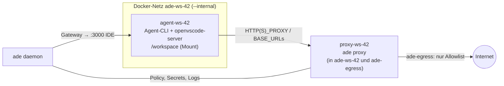

# Sandbox & Egress-Proxy

Ziel: Ein Agent darf in seinem Workspace **alles** tun – aber **nur** dort, und ins Netz
**nur dorthin**, wo die Policy es erlaubt. Er kann weder Secrets lesen noch etwas veröffentlichen.

## 1. Aufbau pro Workspace



- **`ade-ws-<id>`** ist ein `--internal`-Netz: Container darin haben **keine Route nach draußen**.
- Der **Proxy-Container** hängt in beiden Netzen und ist der einzige Weg ins Internet.
- `HTTP_PROXY`/`HTTPS_PROXY` im Agent-Container sind nur Bequemlichkeit – **erzwungen** wird die
  Isolation durch das interne Netz. Ein Programm, das den Proxy ignoriert, erreicht schlicht nichts.
- Der Daemon erreicht IDE und Proxy über ihre Container-IPs bzw. veröffentlichte Ports auf `127.0.0.1`.

## 2. Agent-Container

| Einstellung | Wert |
|---|---|
| Image | `ghcr.io/davidw475/ade-agent-base:<version>` (oder Projekt-Image aus `.ade/sandbox.yaml`) |
| User | non-root (`ade`, UID passend zum WSL-User für saubere Dateirechte) |
| Mounts | nur `~/.ade/workspaces/<id>` → `/workspace` (rw); optional Caches (npm, go) als Volumes |
| Capabilities | `--cap-drop ALL`, `--security-opt no-new-privileges` |
| Ressourcen | `--memory`, `--cpus`, `--pids-limit` aus Policy |
| Verboten | Docker-Socket, Host-Netz, privilegierter Modus, Mount des Haupt-Repos |
| Prozesse | `openvscode-server` (Port 3000, Token), Agent-CLI über `docker exec` mit PTY |

Basis-Image enthält: Debian slim, git, curl, Node.js LTS, Python 3, ripgrep, gängige
Agent-CLIs, openvscode-server, `ade`-Hook-Binary. Projekte können ein eigenes Image ableiten
(`FROM ade-agent-base`) oder Setup-Befehle in `.ade/project.yaml` angeben.

## 3. Egress-Proxy (`ade proxy`)

Ein kleiner HTTP-Forward-Proxy in Go, Teil des `ade`-Binaries.

**Version 1 (ohne TLS-Aufbrechen):**

- `CONNECT host:443` → erlaubt, wenn `host` auf der Allowlist steht; sonst `403`.
- Klartext-HTTP → Prüfung über `Host`-Header.
- Jede Anfrage wird als `egress`-Event an den Daemon gemeldet (erlaubt/geblockt, Host, Bytes).
- Geblockte Anfrage → optional **Freigabe-Anfrage** im Dashboard („Agent will `pypi.org` –
  einmal / immer für dieses Projekt / ablehnen“).

**Später (optional):** TLS-Interception mit eigener CA im Container für Regeln auf
Pfad-/Methodenebene (z. B. GitHub nur lesend). Bewusst nicht in v1 – mehr Komplexität,
mehr Angriffsfläche.

### DNS

Auch im internen Netz beantwortet Docker DNS-Anfragen. Prüfen, ob externe Namen aufgelöst
werden (möglicher Exfiltrationskanal per DNS); falls ja, im Agent-Container nur den Proxy als
Ziel zulassen bzw. externe Auflösung unterbinden. Der Agent braucht keine externe DNS-Auflösung,
da der Proxy für ihn auflöst.

### Policy-Format (`.ade/sandbox.yaml`)

```yaml
image: ghcr.io/davidw475/ade-agent-base:0.1
resources:
  memory: 4g
  cpus: 2
  pids: 512
egress:
  presets: [anthropic, github-readonly, npm, pypi, go-proxy]
  allow:
    - api.example.com
    - "*.githubusercontent.com"
  deny:
    - "*.pastebin.com"
  on_blocked: ask          # ask | deny
```

Presets sind im Binary hinterlegte Domain-Listen (z. B. `npm` → `registry.npmjs.org`).
Policy-Änderungen pusht der Daemon zur Laufzeit an den Proxy – ohne Neustart.

## 4. Secrets

Grundsatz: **Kein API-Key, kein Git-Token im Agent-Container.**

API-Zugriffe der Agent-CLIs laufen über **Basis-URLs, die auf den Proxy zeigen**:

```
ANTHROPIC_BASE_URL=http://proxy:8080/p/anthropic
```

Der Proxy leitet `…/p/anthropic/*` an `https://api.anthropic.com/*` weiter und **fügt den Key
selbst ein**. Der Agent sieht nur einen Platzhalter. Vorteile:

- Ein kompromittierter Agent kann den Key nicht auslesen oder weitergeben.
- Der Proxy kann pro Workspace **Tokens zählen und Budgets erzwingen**.
- Kein TLS-Aufbrechen nötig (Agent → Proxy im internen Netz per HTTP, Proxy → Anbieter per HTTPS).

Ob eine CLI eine konfigurierbare Basis-URL unterstützt, ist pro Adapter zu prüfen
(Claude Code: `ANTHROPIC_BASE_URL`). Für CLIs ohne diese Option bleibt nur Key-im-Container
mit Warnung im Dashboard oder TLS-Interception (später).

**Git:** Der Agent committet lokal im Workspace. `fetch`/`push` zum Remote macht ausschließlich
der Daemon auf dem Host nach Freigabe. Lesender Zugriff auf GitHub (z. B. Abhängigkeiten) geht
über die Allowlist.

**Anmeldung per Abo:** Falls ein Nutzer eine CLI mit eigenem Abo-Login in der Sandbox nutzt,
liegen dessen Credentials im Container (Volume). Das ist bewusst eine Nutzerentscheidung, ADE
zeigt dann einen Hinweis. ADE selbst implementiert keine Abo-Logins von Anbietern
(siehe [decisions.md](decisions.md#adr-010-anbieter-zugang-nur-über-api-keys-oder-offizielle-clis)).

## 5. Lebenszyklus

| Ereignis | Aktion |
|---|---|
| Workspace mit Sandbox angelegt | Netz + Proxy + Agent-Container erstellen, IDE starten |
| Session startet | `docker exec -it agent-ws-<id> <adapter-cmd>` |
| Workspace pausiert | Container stoppen (Dateien bleiben im Workspace-Verzeichnis) |
| Workspace verworfen/übernommen | Container, Netz und Workspace-Verzeichnis löschen |
| Daemon-Neustart | Container per Label `ade.workspace=<id>` wiederfinden und abgleichen |

Alle Docker-Objekte tragen Labels (`ade.managed=true`, `ade.workspace=<id>`), damit `ade gc`
verwaiste Ressourcen sicher aufräumen kann.
