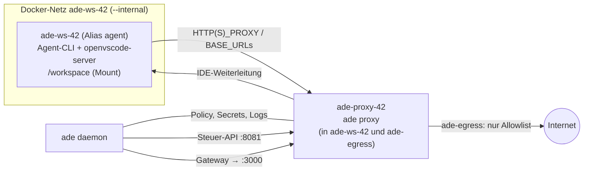

# Sandbox & Egress-Proxy

Ziel: Ein Agent darf in seinem Workspace **alles** tun – aber **nur** dort, und ins Netz
**nur dorthin**, wo die Policy es erlaubt. Er kann weder Secrets lesen noch etwas veröffentlichen.

> **Stand M7:** Alles in diesem Dokument ist umgesetzt, außer TLS-Interception (später).
> Umsetzung: ADR-014 (Container), ADR-015 (Netz, Proxy, Secrets), ADR-016 (Freigaben),
> ADR-023 (rootless Docker und Podman, Abschnitt 6).

## 1. Aufbau pro Workspace



- **`ade-ws-<id>`** ist ein `--internal`-Netz: Container darin haben **keine Route nach draußen**.
- Der **Proxy-Container** hängt in beiden Netzen und ist der einzige Weg ins Internet.
- `HTTP_PROXY`/`HTTPS_PROXY` im Agent-Container sind nur Bequemlichkeit – **erzwungen** wird die
  Isolation durch das interne Netz. Ein Programm, das den Proxy ignoriert, erreicht schlicht nichts.
- **`ade-egress`** ist ein gemeinsames Netz aller Proxys ohne Verkehr zwischen den Containern
  (`enable_icc=false`; unter Podman nicht verfügbar, siehe [Abschnitt 6](#6-container-laufzeiten)).
- Docker veröffentlicht keine Ports von Containern, die nur in internen Netzen hängen. Der Daemon
  erreicht deshalb Steuer-API (`:8081`) und IDE (`:3000`) über veröffentlichte Ports des
  **Proxy-Containers** auf `127.0.0.1`; der Proxy leitet die IDE per TCP an `agent:3000` weiter.
- Der Proxy-Container führt das `ade`-Binary des Daemons aus (nur lesend gemountet, eine Kopie im
  Datenverzeichnis: `<data_dir>/sandbox/ade-proxy`; statisch gebaut), im Standard-Image, als
  Nutzer, ohne Capabilities, mit nur lesendem Dateisystem und kleinen Grenzen.

## 2. Agent-Container

| Einstellung | Wert |
|---|---|
| Image | `ghcr.io/davidw475/ade-agent-base:<version>` (oder Projekt-Image aus `.ade/sandbox.yaml`) |
| User | UID/GID des Daemons (`--user`); fehlt sie im Image, legt ADE einen passwd-Eintrag an. Unter rootless Docker root im Container (= Nutzer auf dem Host), unter Podman `--userns keep-id` ([Abschnitt 6](#6-container-laufzeiten)) |
| Mounts | nur `~/.ade/workspaces/<id>` → `/workspace` (rw); optional Caches (npm, go) als Volumes |
| Capabilities | `--cap-drop ALL`, `--security-opt no-new-privileges` |
| Ressourcen | `--memory`, `--cpus`, `--pids-limit` aus Policy |
| Verboten | Docker-Socket, Host-Netz, privilegierter Modus, Mount des Haupt-Repos |
| Prozesse | `sleep infinity` unter `--init`; `openvscode-server` (Port 3000, Token, auf `127.0.0.1` veröffentlicht), Agent-CLI, Setup-Befehle und git des Daemons über `docker exec` |
| Workspace-Clone | ohne Hardlinks (keine geteilten Objektdateien mit dem Haupt-Repo) |

Basis-Image enthält: Debian slim, git, curl, Node.js LTS, Python 3, ripgrep, gängige
Agent-CLIs, openvscode-server, `ade`-Hook-Binary. Projekte können ein eigenes Image ableiten
(`FROM ade-agent-base`) oder Setup-Befehle in `.ade/project.yaml` angeben.

## 3. Egress-Proxy (`ade proxy`)

Ein kleiner HTTP-Forward-Proxy in Go, Teil des `ade`-Binaries.

**Version 1 (ohne TLS-Aufbrechen):**

- `CONNECT host:port` → erlaubt, wenn `host` auf der Allowlist steht (Einträge ohne Port gelten
  für 80 und 443); sonst `403` mit Begründung.
- Klartext-HTTP (absolute URI) → Prüfung über den Host der URI.
- **Interne Ziele sind immer gesperrt:** Loopback, private Netze (auch Docker-Netze), Link-Local,
  CGNAT, Multicast u. a. Geprüft wird die tatsächlich verwendete IP direkt vor dem `connect`
  (kein DNS-Rebinding), auch wenn ein Name auf der Allowlist steht.
- Jede Anfrage wird als Egress-Event gemeldet (erlaubt/geblockt, Grund, Host, Port, Bytes, Dauer;
  CONNECT-Tunnel beim Schließen). Der Daemon holt sie per Long-Polling ab, speichert die letzten
  2000 je Workspace und zeigt sie in der Ansicht **Netzwerk**.
- Ohne Policy (direkt nach dem Start) ist alles gesperrt.
- **Steuer-API** (`:8081`, nur mit Token aus `ADE_PROXY_TOKEN`; der Agent kennt es nicht):
  `PUT /policy` (Allow/Deny, Keys, Rückfragen), `GET /events`, `GET /questions`,
  `POST /questions/{id}`, `GET /healthz`.
- **Freigaben** (`on_blocked: ask`): Eine Anfrage an ein nicht freigegebenes Ziel wartet (bis zu
  2 min) auf eine Entscheidung im Dashboard („Agent will `pypi.org:443` erreichen“): **Einmal**
  (nur die wartenden Anfragen), **Für diesen Workspace**, **Immer (Projekt)** oder **Ablehnen**
  (bis zum Neustart des Proxys nicht erneut fragen). Ziele auf der deny-Liste und interne
  Adressen fragen nie. Gleichzeitige Anfragen an dasselbe Ziel teilen sich eine Freigabe.
- **Ausnahmen:** „Für diesen Workspace“ und „Immer (Projekt)“ speichert der Daemon in SQLite und
  ergänzt damit die Allowlist – `.ade/sandbox.yaml` im Repo bleibt unverändert. Auch mit
  `on_blocked: deny` lässt sich ein geblockter Host in der Netzwerk-Ansicht mit einem Klick
  erlauben; dort stehen alle Ausnahmen und lassen sich entfernen.
- **Freigabe-Hook:** Der Proxy nimmt unter `/ade/hook/pretooluse` die Fragen von
  `ade hook pretooluse` aus dem Agent-Container entgegen und reicht sie über die Steuer-API an
  den Daemon weiter (doc/architecture.md#43-freigaben). Das ade-Binary ist dafür nur lesend unter
  `/opt/ade/ade` im Agent-Container gemountet.

**Später (optional):** TLS-Interception mit eigener CA im Container für Regeln auf
Pfad-/Methodenebene (z. B. GitHub nur lesend). Bewusst nicht in v1 – mehr Komplexität,
mehr Angriffsfläche.

### DNS

Auch im internen Netz beantwortet Docker DNS-Anfragen (eingebetteter DNS-Server `127.0.0.11`).
Geprüft mit Docker 29: Für `--internal`-Netze leitet er externe Namen nicht weiter, nur
Container-Namen (`proxy`) lösen auf. Unabhängig von der Docker-Version setzt ADE zusätzlich
`--dns 192.0.2.1` (TEST-NET-1, im internen Netz unerreichbar) als Upstream – keine
Loopback-Adresse, denn die würde Docker im Netz-Namespace des Hosts befragen. Der Agent braucht
keine externe Auflösung, der Proxy löst für ihn auf. Ein Docker-Test prüft beides.

### Policy-Format (`.ade/sandbox.yaml`)

```yaml
image: ghcr.io/davidw475/ade-agent-base:0.1
resources:
  memory: 4g
  cpus: 2
  pids: 512
egress:
  presets: [anthropic, openai, github-readonly, npm, pypi, go-proxy]
  allow:
    - api.example.com
    - "*.githubusercontent.com"
  deny:
    - "*.pastebin.com"
  on_blocked: ask          # deny (Standard) oder ask: Freigabe im Dashboard
```

Presets sind im Binary hinterlegte Domain-Listen (`internal/sandbox/egress.go`):

| Preset | Hosts |
|---|---|
| `anthropic` | api.anthropic.com, console.anthropic.com, platform.claude.com, claude.ai, statsig.anthropic.com |
| `openai` | api.openai.com, auth.openai.com, chatgpt.com (Codex CLI: API, ChatGPT-Anmeldung, Modell-Liste) |
| `github-readonly` | github.com, api.github.com, codeload.github.com, raw/objects/release-assets.githubusercontent.com, ghcr.io, pkg-containers.githubusercontent.com |
| `npm` | registry.npmjs.org, registry.yarnpkg.com |
| `pypi` | pypi.org, files.pythonhosted.org |
| `go-proxy` | proxy.golang.org, sum.golang.org |

- Ohne `egress`-Abschnitt gelten `anthropic`, `openai`, `github-readonly`, `npm`, `pypi`, `go-proxy`.
  Mit Abschnitt gilt nur, was dort steht; `egress: {}` sperrt alles.
- `github-readonly` heißt ohne TLS-Aufbrechen nur: Der Container erreicht GitHub, hat aber keine
  Zugangsdaten dafür. Schreibzugriffe scheitern an der Anmeldung, nicht am Proxy.
- `deny` geht vor `allow`; ein Eintrag ohne Port sperrt alle Ports.
- Der Daemon liest die Datei aus dem Haupt-Repo und schickt Änderungen alle paar Sekunden an
  laufende Proxys – ohne Neustart. Ist die Datei ungültig, behalten laufende Proxys die zuletzt
  gültige Policy, und neue Container starten erst nach der Korrektur (kein stilles Zurückfallen
  auf die Voreinstellung).

## 4. Secrets

Grundsatz: **Kein API-Key, kein Git-Token im Agent-Container.**

API-Zugriffe der Agent-CLIs laufen über **Basis-URLs, die auf den Proxy zeigen**:

```
ANTHROPIC_BASE_URL=http://proxy:8080/p/anthropic
```

Der Proxy leitet `…/p/anthropic/*` an `https://api.anthropic.com/*` weiter und **fügt den Key
selbst ein**. Der Agent sieht nur einen Platzhalter. Vorteile:

- Ein kompromittierter Agent kann den Key nicht auslesen oder weitergeben.
- Der Proxy kann pro Workspace **Tokens zählen und Budgets erzwingen**.
- Kein TLS-Aufbrechen nötig (Agent → Proxy im internen Netz per HTTP, Proxy → Anbieter per HTTPS).

Ob eine CLI eine konfigurierbare Basis-URL unterstützt, ist pro Adapter zu prüfen
(Claude Code: `ANTHROPIC_BASE_URL`). Für CLIs ohne diese Option bleibt nur Key-im-Container
mit Warnung im Dashboard oder TLS-Interception (später).

Umsetzung (M6 für Anthropic, M8 für OpenAI):

- Der Daemon schickt die aufgelösten Keys (`providers.<name>.api_key`) über die Steuer-API an den
  Proxy. Sie stehen nie in Container-Konfiguration, Umgebung oder Dateien des Agent-Containers.
- Agent-Sessions in der Sandbox bekommen `ANTHROPIC_BASE_URL=http://proxy:8080/p/anthropic`,
  `ANTHROPIC_API_KEY=<Platzhalter>` und `CLAUDE_CODE_DISABLE_NONESSENTIAL_TRAFFIC=1`. Der Proxy
  entfernt `Authorization`/`X-Api-Key` des Clients und setzt den echten Key; Antworten (SSE)
  reicht er ungepuffert durch.
- `proxy` steht in `NO_PROXY`. Clients, die die Basis-URL trotzdem über `HTTP_PROXY` ansprechen,
  bedient der Proxy genauso (Anfragen an sich selbst unter `/p/`).
- Ohne konfigurierten Key bekommt die CLI keine Basis-URL und nutzt ihre eigene Anmeldung über
  die Allowlist (Preset `anthropic` bzw. `openai`).

OpenAI (M8, für Codex):

- `/p/openai/…` geht an `https://api.openai.com/…`, der Proxy setzt `Authorization: Bearer <Key>`.
- Codex beachtet `OPENAI_BASE_URL` nicht. ADE gibt der CLI deshalb einen eigenen Provider als
  Argument (`-c model_provider=ade -c model_providers.ade={base_url="http://proxy:8080/p/openai/v1",
  env_key="OPENAI_API_KEY", wire_api="responses"}`); `OPENAI_API_KEY` ist im Container ein Platzhalter.
- Codex läuft im Container mit `--dangerously-bypass-approvals-and-sandbox`: Der Container ist die
  Sandbox, die eigene von Codex (Landlock/seccomp) ist darin nicht zuverlässig.

**Token-Zählung (M8):** Für `/p/<anbieter>/…` fordert der Proxy unkomprimierte Antworten an und
liest sie beim Durchreichen mit (ohne Puffern): `usage` aus JSON-Antworten und aus den SSE-Events
(`message_start`/`message_delta` bei Anthropic, `response.completed` bei OpenAI, `usage` in
Chat-Chunks). Die Nutzung steht im Egress-Event; der Daemon verbucht sie als Kosten der Session
und prüft die Budgets ([architecture.md](architecture.md#44-kosten-und-budgets)). Was am Proxy
vorbei über CONNECT läuft (Abo-Login), kann er nicht zählen; dann gilt die Meldung der CLI.

**Git:** Der Agent committet lokal im Workspace. `fetch`/`push` zum Remote macht ausschließlich
der Daemon auf dem Host nach Freigabe. Lesender Zugriff auf GitHub (z. B. Abhängigkeiten) geht
über die Allowlist.

**Anmeldung per Abo:** Falls ein Nutzer eine CLI mit eigenem Abo-Login in der Sandbox nutzt,
liegen dessen Credentials im Container (Volume). Das ist bewusst eine Nutzerentscheidung, ADE
zeigt dann einen Hinweis. ADE selbst implementiert keine Abo-Logins von Anbietern
(siehe [decisions.md](decisions.md#adr-010-anbieter-zugang-nur-über-api-keys-oder-offizielle-clis)).

## 5. Lebenszyklus

| Ereignis | Aktion |
|---|---|
| Workspace mit Sandbox angelegt | Netz `ade-ws-<id>`, Proxy `ade-proxy-<id>` und Container `ade-ws-<id>` erstellen und starten (ggf. Image laden), Policy an den Proxy, Setup-Befehle im Container |
| Session startet | `docker exec -it ade-ws-<id> <adapter-cmd>` (startet den Container bei Bedarf) |
| Session stoppt | SIGTERM an alle Prozesse mit `ADE_SESSION_ID=<id>` im Container, nach Timeout SIGKILL |
| IDE öffnen | `docker exec ade-ws-<id> openvscode-server …`, Gateway → veröffentlichter Port des Proxys → `agent:3000` |
| Daemon wird beendet | Container und Proxys stoppen (Dateien bleiben im Workspace-Verzeichnis) |
| Workspace verworfen | Container, Proxy, Netz und Workspace-Verzeichnis löschen |
| Daemon-Start | Container per Label finden: verwaiste (samt Netzen) entfernen, übrige stoppen; Start bei Bedarf. Container aus M5 (Label `ade.net` fehlt) werden beim nächsten Start neu angelegt |

Alle Docker-Objekte tragen Labels (`ade.managed=true`, `ade.workspace=<id>`,
`ade.data_dir=<Datenverzeichnis>`), damit `ade gc` verwaiste Ressourcen sicher aufräumen kann –
auch die einer ADE-Instanz, deren Datenverzeichnis nicht mehr existiert, aber nie die einer
anderen laufenden Instanz.

## 6. Container-Laufzeiten

ADE ruft immer die Docker-CLI-Syntax auf (`sandbox.docker` in `config.yaml`, Standard `docker`).
Dahinter kann Docker oder Podman stehen; ADE erkennt die Laufzeit beim Start der Sandbox über
`<docker> info --format '{{json .}}'` und zeigt sie im Log („Container-Laufzeit erkannt“).

| Laufzeit | Einstellung | UID im Container | Dateien im Workspace gehören |
|---|---|---|---|
| Docker (rootful) | `docker` | UID des Nutzers (`--user`) | dem Nutzer |
| Docker rootless | `docker` mit rootless-Kontext bzw. `DOCKER_HOST` | `0` – root im User-Namespace ist der Nutzer auf dem Host | dem Nutzer |
| Podman (rootless) | `podman` (oder der `docker`-Shim aus `podman-docker`) | UID des Nutzers, `--userns keep-id` | dem Nutzer |
| Podman (rootful) | `podman` als root | wie Docker rootful | dem Nutzer |

Unter rootless Docker bekäme jede andere UID als 0 auf dem Host eine fremde UID aus dem
subuid-Bereich – der Nutzer könnte die Dateien seines Workspaces nicht mehr ändern. Root im
Container hat dort ohne Capabilities (`--cap-drop ALL`, `no-new-privileges`) keine Rechte über die
des Nutzers hinaus. Weil Claude Code `bypassPermissions` als root nur in einer Sandbox erlaubt,
setzt ADE in diesem Fall `IS_SANDBOX=1`.

### Einrichtung

**Podman (rootless):**

```sh
sudo apt install podman            # Ubuntu/Debian; Netz-Backend netavark (Standard ab Podman 4)
podman info --format '{{.Host.NetworkBackend}} {{.Host.CgroupControllers}}'
```

```yaml
# ~/.config/ade/config.yaml
sandbox:
  docker: podman
```

**Docker rootless:** nach der [Docker-Anleitung](https://docs.docker.com/engine/security/rootless/)
einrichten (`dockerd-rootless-setuptool.sh install`). ADE übernimmt `DOCKER_HOST` bzw. den aktiven
Docker-Kontext aus der Umgebung des Daemons; läuft ADE als Dienst (`ade install-service`), gehört
`DOCKER_HOST` in die Umgebung beim Installieren des Dienstes oder der Kontext per `docker context use rootless`.
Für `enable_icc=false` im Egress-Netz braucht rootless Docker das Kernelmodul `br_netfilter`
(rootful lädt Docker es selbst):

```sh
sudo modprobe br_netfilter
echo br_netfilter | sudo tee /etc/modules-load.d/br_netfilter.conf   # dauerhaft
```

**Ressourcen-Grenzen:** Agent- und Proxy-Container haben immer Grenzen für Speicher, CPU und
Prozesse. Rootless setzt das die cgroup-Controller `memory`, `cpu` und `pids` voraus, die systemd
an den Nutzer delegieren muss (cgroups v2). Fehlt einer, bricht ADE den Start der Sandbox mit einer
Meldung ab, statt die Grenzen stillschweigend wegzulassen. Prüfen und delegieren:

```sh
cat /sys/fs/cgroup/user.slice/user-$(id -u).slice/user@$(id -u).service/cgroup.controllers
sudo mkdir -p /etc/systemd/system/user@.service.d
printf '[Service]\nDelegate=cpu cpuset io memory pids\n' | sudo tee /etc/systemd/system/user@.service.d/delegate.conf
sudo systemctl daemon-reload   # danach neu anmelden (unter WSL: wsl --shutdown)
```

Unter WSL2 braucht das `systemd=true` in `/etc/wsl.conf` (ohnehin Voraussetzung für den Dienst).

### Unterschiede und Einschränkungen

| Thema | Docker | Podman |
|---|---|---|
| Internes Netz (`--internal`) | ja | ja (netavark) |
| Kein Verkehr zwischen Proxys in `ade-egress` | `enable_icc=false` | nicht verfügbar – Proxys sehen sich gegenseitig. Ein Agent erreicht trotzdem nur seinen eigenen Proxy, und der lehnt interne Ziele ab |
| Externe Namen im internen Netz nicht auflösbar (`--dns 192.0.2.1`) | ja | ja |
| `--cap-drop ALL`, `no-new-privileges`, `--read-only` | ja | ja |
| Ressourcen-Grenzen | rootful immer, rootless mit delegierten Controllern | wie Docker rootless |
| Ports auf `127.0.0.1` veröffentlichen | ja (rootless über rootlesskit) | ja (pasta bzw. slirp4netns) |

Weitere bekannte Einschränkungen:

- Unter rootless Docker laufen Agent-CLIs als root im Container. Werkzeuge, die root ablehnen oder
  sich anders verhalten (z. B. `npm` mit `unsafe-perm`), verhalten sich wie in einem rootful
  Container als root.
- Podman mit dem alten Netz-Backend CNI wird nicht unterstützt (kein DNS in internen Netzen).
- Die CI prüft die Sandbox-Integrationstests unter Docker, rootless Docker und rootless Podman.
