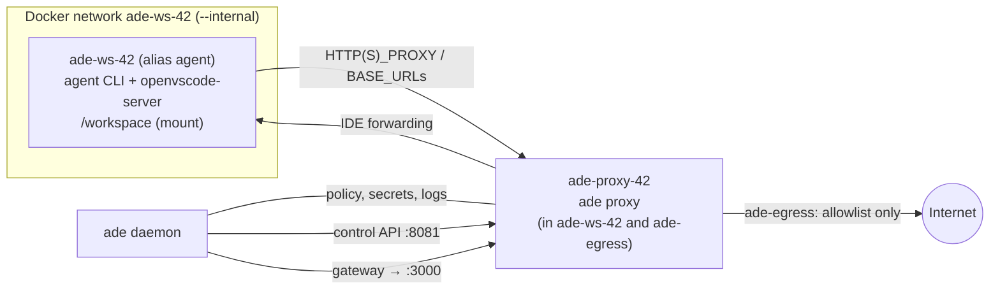

# Sandbox & egress proxy

Goal: an agent may do **anything** in its workspace – but **only** there, and on the network
**only where** the policy allows it. It can neither read secrets nor publish anything.

> **Status M7:** everything in this document is implemented except TLS interception (later).
> Implementation: ADR-014 (containers), ADR-015 (network, proxy, secrets), ADR-016 (approvals),
> ADR-023 (rootless Docker and Podman, section 6).

## 1. Layout per workspace



- **`ade-ws-<id>`** is an `--internal` network: containers in it have **no route to the outside**.
- The **proxy container** is attached to both networks and is the only way to the internet.
- `HTTP_PROXY`/`HTTPS_PROXY` in the agent container are only a convenience – the isolation is
  **enforced** by the internal network. A program that ignores the proxy simply reaches nothing.
- **`ade-egress`** is a shared network of all proxies without traffic between the containers
  (`enable_icc=false`; not available under Podman, see [section 6](#6-container-runtimes)).
- Docker does not publish ports of containers that are only attached to internal networks. The
  daemon therefore reaches the control API (`:8081`) and the IDE (`:3000`) through published ports
  of the **proxy container** on `127.0.0.1`; the proxy forwards the IDE via TCP to `agent:3000`.
- The proxy container runs the daemon's `ade` binary (mounted read-only, a copy in the data
  directory: `<data_dir>/sandbox/ade-proxy`; statically built), in the default image, as a user,
  without capabilities, with a read-only file system and small limits.

## 2. Agent container

| Setting | Value |
|---|---|
| Image | `ghcr.io/davidw475/ade-agent-base:<version>` (or the project image from `.ade/sandbox.yaml`) |
| User | UID/GID of the daemon (`--user`); if it is missing in the image, ADE adds a passwd entry. Under rootless Docker root in the container (= the user on the host), under Podman `--userns keep-id` ([section 6](#6-container-runtimes)) |
| Mounts | only `~/.ade/workspaces/<id>` → `/workspace` (rw); optionally caches (npm, go) as volumes |
| Capabilities | `--cap-drop ALL`, `--security-opt no-new-privileges` |
| Resources | `--memory`, `--cpus`, `--pids-limit` from the policy |
| Forbidden | Docker socket, host network, privileged mode, mounting the main repository |
| Processes | `sleep infinity` under `--init`; `openvscode-server` (port 3000, token, published on `127.0.0.1`), agent CLI, setup commands and the daemon's git via `docker exec` |
| Workspace clone | without hardlinks (no object files shared with the main repository) |

The base image contains: Debian slim, git, curl, Node.js LTS, Python 3, ripgrep, common agent
CLIs, openvscode-server, the `ade` hook binary. Projects can derive their own image
(`FROM ade-agent-base`) or list setup commands in `.ade/project.yaml`.

## 3. Egress proxy (`ade proxy`)

A small HTTP forward proxy in Go, part of the `ade` binary.

**Version 1 (without TLS interception):**

- `CONNECT host:port` → allowed if `host` is on the allowlist (entries without a port apply to
  80 and 443); otherwise `403` with a reason.
- Plain HTTP (absolute URI) → checked by the host of the URI.
- **Internal targets are always blocked:** loopback, private networks (including Docker
  networks), link-local, CGNAT, multicast and others. The IP that is actually used is checked
  right before `connect` (no DNS rebinding), even if a name is on the allowlist.
- Every request is reported as an egress event (allowed/blocked, reason, host, port, bytes,
  duration; CONNECT tunnels when closing). The daemon collects them by long polling, stores the
  latest 2000 per workspace and shows them in the **Network** view.
- Without a policy (right after the start) everything is blocked.
- **Control API** (`:8081`, only with the token from `ADE_PROXY_TOKEN`; the agent does not know
  it): `PUT /policy` (allow/deny, keys, questions), `GET /events`, `GET /questions`,
  `POST /questions/{id}`, `GET /healthz`.
- **Approvals** (`on_blocked: ask`): a request to a target that is not allowed waits (up to
  2 min) for a decision in the dashboard ("Agent wants to reach `pypi.org:443`"): **Once** (only
  the waiting requests), **For this workspace**, **Always (project)** or **Deny** (do not ask
  again until the proxy restarts). Targets on the deny list and internal addresses never ask.
  Concurrent requests to the same target share one approval.
- **Exceptions:** "For this workspace" and "Always (project)" are stored by the daemon in SQLite
  and extend the allowlist – `.ade/sandbox.yaml` in the repository stays unchanged. Even with
  `on_blocked: deny`, a blocked host can be allowed with one click in the network view; all
  exceptions are listed there and can be removed.
- **Approval hook:** at `/ade/hook/pretooluse` the proxy accepts the questions of
  `ade hook pretooluse` from the agent container and passes them to the daemon through the control
  API ([architecture.md](architecture.md#43-approvals)). For this the ade binary is mounted
  read-only at `/opt/ade/ade` in the agent container.

**Later (optional):** TLS interception with an own CA in the container for rules on path/method
level (e.g. GitHub read-only). Deliberately not in v1 – more complexity, more attack surface.

### DNS

Even in the internal network Docker answers DNS queries (embedded DNS server `127.0.0.11`).
Checked with Docker 29: for `--internal` networks it does not forward external names, only
container names (`proxy`) resolve. Independent of the Docker version, ADE additionally sets
`--dns 192.0.2.1` (TEST-NET-1, unreachable in the internal network) as upstream – not a loopback
address, because Docker would query that in the host's network namespace. The agent does not
need external resolution, the proxy resolves for it. A Docker test checks both.

### Policy format (`.ade/sandbox.yaml`)

```yaml
image: ghcr.io/davidw475/ade-agent-base:1.0.0
resources:
  memory: 4g
  cpus: 2
  pids: 512
egress:
  presets: [anthropic, openai, github-readonly, npm, pypi, go-proxy]
  allow:
    - api.example.com
    - "*.githubusercontent.com"
  deny:
    - "*.pastebin.com"
  on_blocked: ask          # deny (default) or ask: approval in the dashboard
```

Presets are domain lists built into the binary (`internal/sandbox/egress.go`):

| Preset | Hosts |
|---|---|
| `anthropic` | api.anthropic.com, console.anthropic.com, platform.claude.com, claude.ai, statsig.anthropic.com |
| `openai` | api.openai.com, auth.openai.com, chatgpt.com (Codex CLI: API, ChatGPT login, model list) |
| `github-readonly` | github.com, api.github.com, codeload.github.com, raw/objects/release-assets.githubusercontent.com, ghcr.io, pkg-containers.githubusercontent.com |
| `npm` | registry.npmjs.org, registry.yarnpkg.com |
| `pypi` | pypi.org, files.pythonhosted.org |
| `go-proxy` | proxy.golang.org, sum.golang.org |

- Without an `egress` section, `anthropic`, `openai`, `github-readonly`, `npm`, `pypi` and
  `go-proxy` apply. With a section only what it lists applies; `egress: {}` blocks everything.
- Without TLS interception, `github-readonly` only means: the container reaches GitHub but has no
  credentials for it. Write access fails at authentication, not at the proxy.
- `deny` wins over `allow`; an entry without a port blocks all ports.
- The daemon reads the file from the main repository and sends changes to running proxies every
  few seconds – without a restart. If the file is invalid, running proxies keep the last valid
  policy and new containers only start after it is fixed (no silent fallback to the defaults).

All options: [configuration.md](configuration.md#adesandboxyaml).

## 4. Secrets

Principle: **no API key and no Git token in the agent container.**

The agent CLIs' API calls go through **base URLs that point to the proxy**:

```
ANTHROPIC_BASE_URL=http://proxy:8080/p/anthropic
```

The proxy forwards `…/p/anthropic/*` to `https://api.anthropic.com/*` and **inserts the key
itself**. The agent only sees a placeholder. Advantages:

- A compromised agent cannot read or pass on the key.
- The proxy can **count tokens and enforce budgets** per workspace.
- No TLS interception needed (agent → proxy via HTTP in the internal network, proxy → provider
  via HTTPS).

Whether a CLI supports a configurable base URL has to be checked per adapter (Claude Code:
`ANTHROPIC_BASE_URL`). For CLIs without this option only key-in-container with a warning in the
dashboard or TLS interception (later) remain.

Implementation (M6 for Anthropic, M8 for OpenAI):

- The daemon sends the resolved keys (`providers.<name>.api_key`) to the proxy through the
  control API. They never appear in the container configuration, environment or files of the
  agent container.
- Agent sessions in the sandbox get `ANTHROPIC_BASE_URL=http://proxy:8080/p/anthropic`,
  `ANTHROPIC_API_KEY=<placeholder>` and `CLAUDE_CODE_DISABLE_NONESSENTIAL_TRAFFIC=1`. The proxy
  removes the client's `Authorization`/`X-Api-Key` and sets the real key; it passes responses
  (SSE) through unbuffered.
- `proxy` is in `NO_PROXY`. Clients that still address the base URL through `HTTP_PROXY` are
  served the same way (requests to the proxy itself under `/p/`).
- Without a configured key the CLI gets no base URL and uses its own login through the allowlist
  (preset `anthropic` or `openai`).

OpenAI (M8, for Codex):

- `/p/openai/…` goes to `https://api.openai.com/…`, the proxy sets `Authorization: Bearer <key>`.
- Codex ignores `OPENAI_BASE_URL`. ADE therefore passes an own provider to the CLI as an argument
  (`-c model_provider=ade -c model_providers.ade={base_url="http://proxy:8080/p/openai/v1",
  env_key="OPENAI_API_KEY", wire_api="responses"}`); `OPENAI_API_KEY` is a placeholder in the
  container.
- Codex runs in the container with `--dangerously-bypass-approvals-and-sandbox`: the container is
  the sandbox, Codex's own one (Landlock/seccomp) is not reliable inside it.

**Token counting (M8):** for `/p/<provider>/…` the proxy requests uncompressed responses and
reads along while passing them through (without buffering): `usage` from JSON responses and from
the SSE events (`message_start`/`message_delta` for Anthropic, `response.completed` for OpenAI,
`usage` in chat chunks). The usage is part of the egress event; the daemon books it as costs of
the session and checks the budgets ([architecture.md](architecture.md#44-costs-and-budgets)).
Whatever bypasses the proxy via CONNECT (subscription login) cannot be counted; then the CLI's
report counts.

**Git:** the agent commits locally in the workspace. Only the daemon on the host does
`fetch`/`push` to the remote, after approval. Read access to GitHub (e.g. dependencies) goes
through the allowlist.

**Subscription login:** if a user uses a CLI with its own subscription login in the sandbox, its
credentials are in the container (volume). This is deliberately the user's decision; ADE then
shows a notice. ADE itself does not implement providers' subscription logins
(see [decisions.md](decisions.md#adr-010-provider-access-only-via-api-keys-or-official-clis)).

## 5. Life cycle

| Event | Action |
|---|---|
| Workspace with sandbox created | Create and start network `ade-ws-<id>`, proxy `ade-proxy-<id>` and container `ade-ws-<id>` (pull the image if needed), policy to the proxy, setup commands in the container |
| Session starts | `docker exec -it ade-ws-<id> <adapter-cmd>` (starts the container if needed) |
| Session stops | SIGTERM to all processes with `ADE_SESSION_ID=<id>` in the container, SIGKILL after a timeout |
| Open IDE | `docker exec ade-ws-<id> openvscode-server …`, gateway → published port of the proxy → `agent:3000` |
| Daemon stops | Stop containers and proxies (files stay in the workspace directory) |
| Workspace discarded | Delete container, proxy, network and workspace directory |
| Daemon start | Find containers by label: remove orphaned ones (including networks), stop the others; start on demand. Containers from M5 (label `ade.net` missing) are recreated on the next start |

All Docker objects carry labels (`ade.managed=true`, `ade.workspace=<id>`,
`ade.data_dir=<data directory>`), so `ade gc` can safely clean up orphaned resources – including
those of an ADE instance whose data directory no longer exists, but never those of another
running instance.

## 6. Container runtimes

ADE always uses the Docker CLI syntax (`sandbox.docker` in `config.yaml`, default `docker`).
Behind it can be Docker or Podman; ADE detects the runtime when the sandbox starts via
`<docker> info --format '{{json .}}'` and shows it in the log ("container runtime detected") and
in the dashboard.

| Runtime | Setting | UID in the container | Files in the workspace belong to |
|---|---|---|---|
| Docker (rootful) | `docker` | UID of the user (`--user`) | the user |
| Docker rootless | `docker` with rootless context or `DOCKER_HOST` | `0` – root in the user namespace is the user on the host | the user |
| Podman (rootless) | `podman` (or the `docker` shim from `podman-docker`) | UID of the user, `--userns keep-id` | the user |
| Podman (rootful) | `podman` as root | like Docker rootful | the user |

Under rootless Docker any UID other than 0 would map to a foreign UID from the subuid range on the
host – the user could no longer change the files of their workspace. Root in the container has no
rights beyond the user's without capabilities (`--cap-drop ALL`, `no-new-privileges`). Because
Claude Code only allows `bypassPermissions` as root inside a sandbox, ADE sets `IS_SANDBOX=1` in
this case.

### Setup

**Podman (rootless):**

```sh
sudo apt install podman            # Ubuntu/Debian; network backend netavark (default since Podman 4)
podman info --format '{{.Host.NetworkBackend}} {{.Host.CgroupControllers}}'
```

```yaml
# ~/.config/ade/config.yaml
sandbox:
  docker: podman
```

**Docker rootless:** set it up following the
[Docker guide](https://docs.docker.com/engine/security/rootless/)
(`dockerd-rootless-setuptool.sh install`). ADE takes `DOCKER_HOST` or the active Docker context
from the daemon's environment; if ADE runs as a service (`ade install-service`), `DOCKER_HOST`
must be in the environment when installing the service, or the context set with
`docker context use rootless`. For `enable_icc=false` in the egress network, rootless Docker needs
the kernel module `br_netfilter` (rootful Docker loads it itself):

```sh
sudo modprobe br_netfilter
echo br_netfilter | sudo tee /etc/modules-load.d/br_netfilter.conf   # permanently
```

**Resource limits:** agent and proxy containers always have limits for memory, CPU and processes.
Rootless, this requires the cgroup controllers `memory`, `cpu` and `pids`, which systemd must
delegate to the user (cgroups v2). If one is missing, ADE aborts the sandbox start with a message
instead of silently dropping the limits. Check and delegate:

```sh
cat /sys/fs/cgroup/user.slice/user-$(id -u).slice/user@$(id -u).service/cgroup.controllers
sudo mkdir -p /etc/systemd/system/user@.service.d
printf '[Service]\nDelegate=cpu cpuset io memory pids\n' | sudo tee /etc/systemd/system/user@.service.d/delegate.conf
sudo systemctl daemon-reload   # then log in again (under WSL: wsl --shutdown)
```

Under WSL2 this needs `systemd=true` in `/etc/wsl.conf` (a requirement for the service anyway).

### Differences and limitations

| Topic | Docker | Podman |
|---|---|---|
| Internal network (`--internal`) | yes | yes (netavark) |
| No traffic between proxies in `ade-egress` | `enable_icc=false` | not available – proxies see each other. An agent still only reaches its own proxy, and that one rejects internal targets |
| External names not resolvable in the internal network (`--dns 192.0.2.1`) | yes | yes |
| `--cap-drop ALL`, `no-new-privileges`, `--read-only` | yes | yes |
| Resource limits | rootful always, rootless with delegated controllers | like Docker rootless |
| Publishing ports on `127.0.0.1` | yes (rootless via rootlesskit) | yes (pasta or slirp4netns) |

Further known limitations:

- Under rootless Docker, agent CLIs run as root in the container. Tools that refuse root or behave
  differently (e.g. `npm` with `unsafe-perm`) behave as in a rootful container as root.
- Podman with the old network backend CNI is not supported (no DNS in internal networks).
- CI runs the sandbox integration tests under Docker, rootless Docker and rootless Podman.
